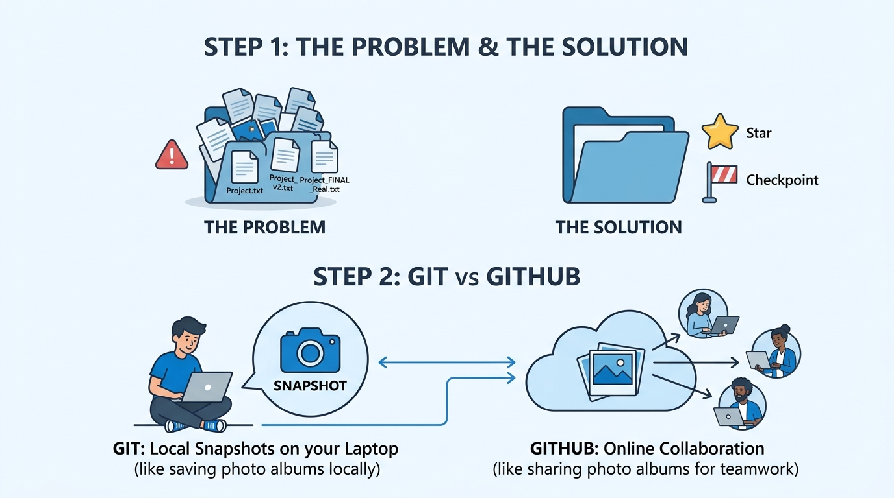

# 🚀 30-Day Git & GitHub Developer Roadmap

A structured, practical day-by-day roadmap designed for developers, students, and engineers to master Git version control, collaborative GitHub workflows, open-source contribution, and automated CI/CD pipelines.

---

## 📅 Roadmap Overview

| Day | Learning Module | Topics to Cover | Practical Task | Status |
| :---: | :--- | :--- | :--- | :---: |
| **00** | **Orientation & Computer Literacy** | The Big Picture, Git vs GitHub, computer storage basics, GUI vs CLI, Local vs Remote, vocabulary cheat sheet | Review mental models, analogies, and glossary before Day 1 | [ ] |
| **01** | **Version Control Fundamentals** | What is version control, why use it, Git vs other VCS, installing Git locally | Install Git and verify the installation | [ ] |
| **02** | **Git Configuration** | `git config`, local vs global configuration | Configure your username and email | [ ] |
| **03** | **Repository Basics** | Repository initialization, `git init`, working directory, staging area | Create a repository and inspect its files | [ ] |
| **04** | **Basic Git Commands** | `git add`, `git commit`, viewing commit history, `.gitignore` | Make commits and ignore unnecessary files | [ ] |
| **05** | **GitHub Essentials** | Creating a GitHub account, GitHub interface, profile setup, profile README | Set up your GitHub profile | [ ] |
| **06** | **Repositories & Documentation** | Creating repositories, public vs private repositories, Markdown, project README, commit messages | Create a repository with a proper README | [ ] |
| **07** | **Git Remotes** | Cloning repositories, managing remotes, pushing and pulling changes, fetching without merging | Push a local project to GitHub and clone it | [ ] |
| **08** | **Branching Basics** | Creating, renaming, deleting, and checking out branches | Create and switch between feature branches | [ ] |
| **09** | **Merging & Collaboration** | Merging basics, fast-forward vs non-fast-forward merges, merge strategies | Merge a feature branch into the main branch | [ ] |
| **10** | **Conflict Resolution** | Handling merge conflicts, resolving conflicts, validating changes | Create and resolve a merge conflict | [ ] |
| **11** | **Advanced Branch Collaboration** | Forking vs cloning, pull requests from forks, collaborators, creating pull requests | Fork a repository and submit a pull request | [ ] |
| **12** | **Pull Request Workflow** | PR guidelines, code reviews, branch naming, contribution guidelines | Open a PR with a clear description | [ ] |
| **13** | **GitHub Issues** | Issues, labels for issues and PRs, saved replies, mentions, reactions, commenting | Create an issue and participate in a discussion | [ ] |
| **14** | **GitHub Collaboration** | GitHub Discussions, GitHub Wikis, documentation, `CITATION` files | Improve a repository's documentation | [ ] |
| **15** | **Git Stash & History** | Git stash basics, linear vs non-linear history, `HEAD`, detached `HEAD`, `git log` options | Save temporary changes and inspect commit history | [ ] |
| **16** | **Undoing Changes** | `git revert`, `git reset --soft`, `--mixed`, `--hard` | Practice undoing changes in a test repository | [ ] |
| **17** | **Rewriting History** | `git commit --amend`, `git rebase`, `git filter-branch`, `git push --force` | Practice amending and rebasing commits safely | [ ] |
| **18** | **Advanced Git Operations** | Cherry-picking commits, Git patch, submodules | Apply a selected commit and explore a submodule | [ ] |
| **19** | **Git Hooks** | What and why, adding/updating hooks, common hooks: `pre-commit`, `commit-msg`, `pre-push`, `post-checkout`, `post-update` | Create a hook to validate commit messages | [ ] |
| **20** | **Tags & Releases** | Managing tags, pushing tags, checking out tags, GitHub Releases | Tag a version and publish a release | [ ] |
| **21** | **GitHub Projects** | Project planning, Kanban boards, roadmaps, automations | Build a project board for a team project | [ ] |
| **22** | **Working in a Team** | Collaborators and members, GitHub Organizations, teams within organizations | Set up a collaborative workflow | [ ] |
| **23** | **GitHub CLI** | Installation, setup, repository management, issue management, pull requests, automation | Use the CLI to manage a repository | [ ] |
| **24** | **Advanced Git Tools** | `git reflog`, `git bisect`, `git worktree`, `git attributes`, Git LFS | Investigate a previous commit and explore large-file management | [ ] |
| **25** | **GitHub Actions Fundamentals** | What and why, use cases, YAML syntax, workflow triggers | Create a basic GitHub Actions workflow | [ ] |
| **26** | **GitHub Actions Advanced** | Scheduled workflows, workflow runners, workflow context, secrets and environment variables | Run a scheduled workflow using repository secrets | [ ] |
| **27** | **CI/CD & Workflow Management** | Caching dependencies, storing artifacts, workflow status, Marketplace Actions | Add a build or test workflow to a project | [ ] |
| **28** | **GitHub APIs & Integrations** | REST API, GraphQL API, GitHub Apps, OAuth Apps, creating apps, webhooks | Explore repository data through the GitHub API | [ ] |
| **29** | **GitHub Developer Tools** | GitHub Copilot, GitHub Models, GitHub Gists, GitHub Packages, GitHub Marketplace, GitHub Codespaces | Explore developer tools and publish a useful code snippet | [ ] |
| **30** | **Publishing & GitHub Ecosystem** | GitHub Pages, deploying static websites, custom domains, static site generators, GitHub Education, Student Developer Pack, GitHub Classroom, Campus Program, GitHub Security, GitHub Sponsors | Deploy a static website to GitHub Pages and explore the developer ecosystem | [ ] |

---

## 🧭 Day 0: Orientation & Computer Literacy (Before You Begin)

> [!NOTE]
> Day 0 is an orientation guide designed for absolute beginners. Read this before touching any terminal commands or code editors to build the right mental models.

  
  
<em>Figure 0.1: Visualizing the Problem vs. Solution and Git (Local Tool) vs. GitHub (Cloud Collaboration).</em>

---

### Module 1: The Big Picture — What Problem Does Git Solve?

#### 1. The "Final_v2" Nightmare
When beginners work on a document, an essay, or a coding project, they usually save their progress by duplicating files:
- `Project.txt`
- `Project_v2.txt`
- `Project_Final.txt`
- `Project_REAL_FINAL_Edited_by_Rahul.txt`

**Why this fails:**
* **Confusion**: Nobody knows which file is the actual latest version.
* **Lost Work**: If you delete a paragraph on Tuesday and want it back on Friday, it is gone forever unless you kept Tuesday's copy.
* **Team Collisions**: If two students edit the same file on their own laptops and email them back to each other, someone has to manually copy-paste the changes together line by line.

#### 2. The Solution: A Time Machine for Your Project
Instead of making 20 copies of a folder, you keep **one single folder**. A special program watches that folder in the background. Every time you reach a milestone, you tell the program to take a **"snapshot"** of how the folder looks at that exact second.

* You can rewind to any snapshot from last week or last year.
* You can see the exact lines that changed between Monday and Tuesday.
* Multiple people can work on the same project simultaneously without overwriting each other's work.

> [!TIP]
> **Teacher Analogy to Share with Students:**  
> *"Think of your project like a video game. Before you fight a tough boss (or try a risky change in your code), you create a Save Point. If you mess up, you don't restart the whole game—you just reload your last Save Point. Git is a Save Point system for your files."*

---

### Module 2: Git vs. GitHub (Clearing Up the #1 Beginner Confusion)

Beginners almost always think Git and GitHub are the same thing, or that "Git" is just a nickname for "GitHub." They are completely different things that work together:

| Feature | Git | GitHub |
| :--- | :--- | :--- |
| **What is it?** | A software tool installed on your computer. | A website on the internet (`github.com`). |
| **Internet needed?** | **No.** Works 100% offline on your laptop. | **Yes.** It is an online cloud service. |
| **What does it do?** | Tracks your changes and saves your history locally. | Stores an online backup of your Git projects so teams can share them. |
| **Who owns it?** | Free, open-source software created by Linus Torvalds in 2005. | A company (owned by Microsoft) that hosts Git projects online. |

> [!TIP]
> **Teacher Analogy to Share with Students:**  
> *"Git is like the Camera app on your phone—it takes photos (snapshots) and stores them on your phone even without Wi-Fi. GitHub is like Google Photos or Instagram—it is the website where you upload those photos to back them up and share them with friends."*

---

### Module 3: How Computers Store Information (Computer Literacy Basics)

Because Git works directly with your computer's file system, students must understand these five foundational computer concepts before Day 1:

1. **Files vs. Directories (Folders):**
   * A **File** is a single item (like a photo, a song, or a text document).
   * A **Directory** is the technical word developers use for a **Folder**. Folders hold files and other folders. Whenever you read *"Working Directory"* on Day 3, just translate it in your head to *"Working Folder"*.
2. **File Paths (Your File's Street Address):**
   * Every file on a computer has a unique address showing which folders it sits inside.
   * *Example*: `Desktop -> School -> Project -> notes.txt` is written as `Desktop/School/Project/notes.txt`.
3. **File Extensions (File Types):**
   * The letters after the dot at the end of a file name tell the computer what kind of file it is (e.g., `.mp3` is audio, `.jpg` is an image, `.txt` is plain text, `.md` is Markdown).
4. **Hidden Files:**
   * Computers hide important system files so users don't accidentally delete them. In the coding world, any file or folder whose name starts with a dot (like `.git` or `.gitignore`) is invisible in your normal folder view unless you enable "Show hidden files".
5. **Plain Text vs. Rich Text (Word Processors):**
   * **Rich Text (Microsoft Word, Google Docs):** Saves hidden formatting data (bolding, fonts, page margins) alongside your words. Git cannot easily read these line-by-line.
   * **Plain Text (Notepad, VS Code):** Saves pure characters and nothing else. Git is built specifically to track Plain Text files line by line (code, notes, configuration files).

---

### Module 4: Two Ways to Talk to a Computer (GUI vs. CLI)

When students start using Git, they will see a black screen with text instead of buttons. Here is why:

* **GUI (Graphical User Interface):** Pronounced *"gooey."* This is how you normally use a computer—clicking icons, dragging folders with a mouse, and pressing visual buttons.
* **CLI (Command Line Interface) / Terminal:** This is how developers talk to a computer—by typing short text sentences (commands) to tell the computer what to do.

#### Why do we learn Git using Text Commands instead of Mouse Clicks?
1. **Universal:** Visual apps look different on Windows, Mac, and Linux, and change their buttons every year. Text commands in Git have been the exact same on every computer in the world for 20 years.
2. **Full Power:** Mouse-click apps only have buttons for about 30% of what Git can do. The terminal gives you 100% control.
3. **Speed & Automation:** Typing a two-word command takes 2 seconds compared to clicking through five menus.

---

### Module 5: Local vs. Remote (Where Your Files Live)

Throughout the 30-day course (especially starting on Day 2 and Day 7), you will constantly hear the words **Local** and **Remote**:

* **Local:** Means *"on your physical laptop/computer right in front of you"*. If your Wi-Fi dies, you still have everything that is local.
* **Remote:** Means *"on a server somewhere else on the internet"* (like on GitHub's servers).

#### Uploading and Downloading in Git Terms:
* Moving files from **Local ➔ Remote** is called **Pushing**.
* Moving files from **Remote ➔ Local** is called **Pulling** (or **Cloning** when downloading a project for the very first time).

---

### Module 6: Day 0 Vocabulary Cheat Sheet (For Students to Memorize)

Hand this glossary to your students so they aren't intimidated by the jargon in Week 1:

* **Version Control System (VCS):** Software that tracks and manages changes to files over time.
* **Repository (or "Repo"):** A project folder that Git is actively watching and tracking. (*Normal folder = Directory; Git-tracked folder = Repository*).
* **Commit:** A saved snapshot (or "Save Point") of your project at a specific moment in time.
* **Terminal / Command Prompt / Shell:** The text-based window where you type instructions to your computer.
* **Code Editor:** A plain-text program (like VS Code) used to write code or text files without hidden Word formatting.
* **Cloud / Server:** A powerful computer connected to the internet that stores websites and files (like GitHub) so you can access them from anywhere.

---

## 📚 Detailed Weekly Breakdown

### 🎯 Week 1: Git & GitHub Foundations (Days 1–7)
Focus: Understanding how Git models snapshots, setting up local and remote environments, making commits, and connecting to GitHub.

- **Day 1: Version Control Fundamentals**
  - *Topics*: What is version control, why use it, Git vs other VCS (SVN, Mercurial), installing Git locally.
  - *Practical*: Install Git (`git --version`) and verify terminal access.
- **Day 2: Git Configuration**
  - *Topics*: `git config`, local vs global configuration, system defaults.
  - *Practical*: Run `git config --global user.name "Your Name"` and `git config --global user.email "you@domain.com"`.
- **Day 3: Repository Basics**
  - *Topics*: Repository initialization, `git init`, working directory, staging area (index), `.git` anatomy.
  - *Practical*: Initialize a repository with `git init` and inspect hidden `.git` files.
- **Day 4: Basic Git Commands**
  - *Topics*: `git status`, `git add`, `git commit -m`, inspecting log history, configuring `.gitignore`.
  - *Practical*: Stage files, craft atomic commits, and ignore build directories/environment files.
- **Day 5: GitHub Essentials**
  - *Topics*: Creating a GitHub account, interface navigation, profile setup, profile README (`username/username`).
  - *Practical*: Create your special GitHub profile repository with Markdown bio and badges.
- **Day 6: Repositories & Documentation**
  - *Topics*: Creating public vs private repositories, writing Markdown, README structure, Conventional Commit messages.
  - *Practical*: Create a repository with a structured `README.md` and license.
- **Day 7: Git Remotes**
  - *Topics*: Remote repositories, `git remote add`, `git push -u`, `git pull`, fetching changes without merging (`git fetch`).
  - *Practical*: Connect your local repository to a remote GitHub repository and push your `main` branch.

---

### 🌿 Week 2: Branching, Merging & History (Days 8–14)
Focus: Branch management, merging strategies, resolving conflicts, and team collaboration workflows.

- **Day 8: Branching Basics**
  - *Topics*: Creating, renaming, deleting, and switching branches (`git branch`, `git switch`, `git checkout -b`).
  - *Practical*: Create a feature branch `feature/navbar`, add changes, and switch between branches.
- **Day 9: Merging & Collaboration**
  - *Topics*: Merging fundamentals, Fast-Forward merges vs 3-Way merge commits (`--no-ff`), merge strategies.
  - *Practical*: Merge a completed feature branch into the `main` branch.
- **Day 10: Conflict Resolution**
  - *Topics*: Understanding merge conflicts, conflict markers (`<<<<<<<`, `=======`, `>>>>>>>`), resolving and committing.
  - *Practical*: Intentionally create a merge conflict on the same line across two branches, resolve it, and verify changes.
- **Day 11: Advanced Branch Collaboration**
  - *Topics*: Forking vs cloning, upstream remotes, adding collaborators, open-source contribution cycle.
  - *Practical*: Fork an open-source repository and submit a pull request.
- **Day 12: Pull Request Workflow**
  - *Topics*: PR guidelines, code review etiquette, branch naming conventions, contribution guidelines (`CONTRIBUTING.md`).
  - *Practical*: Open a pull request with a descriptive summary, issue link, and screenshots.
- **Day 13: GitHub Issues**
  - *Topics*: Issue tracking, issue templates, labels (bug, enhancement), milestone assignments, saved replies, cross-linking.
  - *Practical*: Create an issue reporting a bug or requesting a feature with markdown checkboxes.
- **Day 14: GitHub Collaboration**
  - *Topics*: GitHub Discussions, GitHub Wikis, architectural documentation, and `CITATION.cff` files.
  - *Practical*: Document repository usage in a GitHub Wiki or GitHub Discussion thread.

---

### 🧰 Week 3: Stashing, Undoing & Advanced Team Operations (Days 15–21)
Focus: History manipulation, disaster recovery, stashing, and project planning.

- **Day 15: Git Stash & History**
  - *Topics*: `git stash`, `git stash pop`, `git stash list`, inspecting commit graphs with `git log --oneline --graph --all`.
  - *Practical*: Stash temporary uncommitted changes, switch branches, return, and apply stashed work.
- **Day 16: Undoing Changes**
  - *Topics*: `git restore`, `git revert`, `git reset` (`--soft`, `--mixed`, `--hard`), understanding detached HEAD.
  - *Practical*: Practice safely undoing uncommitted changes and reverting a published commit.
- **Day 17: Rewriting History**
  - *Topics*: `git commit --amend`, interactive rebase (`git rebase -i`), squashing commits, force pushing safety (`--force-with-lease`).
  - *Practical*: Amend the most recent commit message and squash multiple experimental commits into one clean commit.
- **Day 18: Advanced Git Operations**
  - *Topics*: Cherry-picking specific commits (`git cherry-pick`), Git patches (`git format-patch`), Git submodules.
  - *Practical*: Cherry-pick a bug fix from one branch into another without merging the whole branch.
- **Day 19: Git Hooks**
  - *Topics*: Client-side vs server-side hooks, `pre-commit`, `commit-msg`, `pre-push`, automating linting and testing.
  - *Practical*: Write a simple shell script in `.git/hooks/commit-msg` to enforce ticket prefixes on commit messages.
- **Day 20: Tags & Releases**
  - *Topics*: Lightweight vs annotated tags (`git tag -a`), Semantic Versioning (`v1.0.0`), GitHub Releases with release notes.
  - *Practical*: Tag a commit with `v1.0.0` and publish an official Release on GitHub with binary/source attachments.
- **Day 21: GitHub Projects**
  - *Topics*: Project planning, Kanban boards, roadmaps, automations, issue-to-card linking.
  - *Practical*: Build an automated GitHub Project board with "Todo", "In Progress", and "Done" columns.

---

### ⚡ Week 4: Power Tools, CI/CD, APIs & Ecosystem (Days 22–30)
Focus: Command-line productivity, GitHub Actions CI/CD pipelines, APIs, Copilot, and static deployment.

- **Day 22: Working in a Team**
  - *Topics*: Collaborators vs members, GitHub Organizations, team permissions, code owners (`CODEOWNERS`).
  - *Practical*: Create a GitHub Organization, set up team permissions, and assign code ownership rules.
- **Day 23: GitHub CLI (`gh`)**
  - *Topics*: Installing `gh`, authentication, creating repositories, viewing issues, checking out PRs from CLI.
  - *Practical*: Clone a repository, create an issue, and submit a PR entirely using the `gh` terminal tool.
- **Day 24: Advanced Git Tools**
  - *Topics*: Disaster recovery with `git reflog`, binary search debugging with `git bisect`, `git worktree`, Git LFS.
  - *Practical*: Use `git reflog` to recover a deleted branch, and run `git bisect` to locate a regression commit.
- **Day 25: GitHub Actions Fundamentals**
  - *Topics*: CI/CD concepts, YAML workflow syntax, triggers (`push`, `pull_request`, `workflow_dispatch`), jobs and steps.
  - *Practical*: Create `.github/workflows/ci.yml` that runs on push and prints a greeting or runs a test command.
- **Day 26: GitHub Actions Advanced**
  - *Topics*: Scheduled workflows (cron), self-hosted vs GitHub runners, repository secrets, environment variables.
  - *Practical*: Configure encrypted repository secrets (`Settings > Secrets`) and consume them safely in a workflow.
- **Day 27: CI/CD & Workflow Management**
  - *Topics*: Action dependency caching, build artifacts upload/download, matrix builds, Marketplace Actions.
  - *Practical*: Add an automated linting and test runner workflow to a repository with status check badges.
- **Day 28: GitHub APIs & Integrations**
  - *Topics*: GitHub REST API, GraphQL API, personal access tokens (PAT), Webhooks, GitHub Apps vs OAuth Apps.
  - *Practical*: Query public user or repository data using `curl` or `fetch` via the GitHub REST API.
- **Day 29: GitHub Developer Tools**
  - *Topics*: GitHub Copilot, GitHub Models, GitHub Gists, GitHub Packages, GitHub Marketplace, Codespaces.
  - *Practical*: Spin up an instant cloud development environment with GitHub Codespaces and publish a useful Gist.
- **Day 30: Publishing & GitHub Ecosystem**
  - *Topics*: GitHub Pages static site hosting, custom domains, GitHub Education, Student Developer Pack, GitHub Sponsors.
  - *Practical*: Deploy a static portfolio or documentation website to GitHub Pages (`gh-pages` or `/docs`).

---

## 🏆 Completion Checklist

- [ ] Day 0 Completed (Orientation & Computer Literacy)
- [ ] Week 1 Completed (Foundations & Daily Workflow)
- [ ] Week 2 Completed (Branching, Merging & Collaboration)
- [ ] Week 3 Completed (History, Stashing & Teamwork)
- [ ] Week 4 Completed (Power Tools, CI/CD & Ecosystem)

---
*Created for the **Microsoft Student Club (MSC PRPCEM)** learning curriculum.*
