# 🚀 30-Day Git & GitHub Developer Roadmap

A structured, practical day-by-day roadmap designed for developers, students, and engineers to master Git version control, collaborative GitHub workflows, open-source contribution, and automated CI/CD pipelines.

---

## 📅 Roadmap Overview

| Day | Learning Module | Topics to Cover | Practical Task | Status |
| :---: | :--- | :--- | :--- | :---: |
| **00** | **Orientation & Computer Literacy** | The Big Picture, Git vs GitHub, computer storage basics, GUI vs CLI, Local vs Remote, vocabulary cheat sheet | Review mental models, analogies, and glossary before Day 1 | [ ] |
| **01** | **Version Control Fundamentals** | What is version control, why use it, Git vs other VCS, installing Git locally | Install Git and verify the installation | [ ] |
| **02** | **Git Configuration** | `git config`, local vs global configuration | Configure your username and email | [ ] |
| **03** | **Repository Basics** | Repository initialization, `git init`, working directory, staging area | Create a repository and inspect its files | [ ] |
| **04** | **Basic Git Commands** | `git add`, `git commit`, viewing commit history, `.gitignore` | Make commits and ignore unnecessary files | [ ] |
| **05** | **GitHub Essentials** | Creating a GitHub account, GitHub interface, profile setup, profile README | Set up your GitHub profile | [ ] |
| **06** | **Repositories & Documentation** | Creating repositories, public vs private repositories, Markdown, project README, commit messages | Create a repository with a proper README | [ ] |
| **07** | **Git Remotes** | Cloning repositories, managing remotes, pushing and pulling changes, fetching without merging | Push a local project to GitHub and clone it | [ ] |
| **08** | **Branching Basics** | Creating, renaming, deleting, and checking out branches | Create and switch between feature branches | [ ] |
| **09** | **Merging & Collaboration** | Merging basics, fast-forward vs non-fast-forward merges, merge strategies | Merge a feature branch into the main branch | [ ] |
| **10** | **Conflict Resolution** | Handling merge conflicts, resolving conflicts, validating changes | Create and resolve a merge conflict | [ ] |
| **11** | **Advanced Branch Collaboration** | Forking vs cloning, pull requests from forks, collaborators, creating pull requests | Fork a repository and submit a pull request | [ ] |
| **12** | **Pull Request Workflow** | PR guidelines, code reviews, branch naming, contribution guidelines | Open a PR with a clear description | [ ] |
| **13** | **GitHub Issues** | Issues, labels for issues and PRs, saved replies, mentions, reactions, commenting | Create an issue and participate in a discussion | [ ] |
| **14** | **GitHub Collaboration** | GitHub Discussions, GitHub Wikis, documentation, `CITATION` files | Improve a repository's documentation | [ ] |
| **15** | **Git Stash & History** | Git stash basics, linear vs non-linear history, `HEAD`, detached `HEAD`, `git log` options | Save temporary changes and inspect commit history | [ ] |
| **16** | **Undoing Changes** | `git revert`, `git reset --soft`, `--mixed`, `--hard` | Practice undoing changes in a test repository | [ ] |
| **17** | **Rewriting History** | `git commit --amend`, `git rebase`, `git filter-branch`, `git push --force` | Practice amending and rebasing commits safely | [ ] |
| **18** | **Advanced Git Operations** | Cherry-picking commits, Git patch, submodules | Apply a selected commit and explore a submodule | [ ] |
| **19** | **Git Hooks** | What and why, adding/updating hooks, common hooks: `pre-commit`, `commit-msg`, `pre-push`, `post-checkout`, `post-update` | Create a hook to validate commit messages | [ ] |
| **20** | **Tags & Releases** | Managing tags, pushing tags, checking out tags, GitHub Releases | Tag a version and publish a release | [ ] |
| **21** | **GitHub Projects** | Project planning, Kanban boards, roadmaps, automations | Build a project board for a team project | [ ] |
| **22** | **Working in a Team** | Collaborators and members, GitHub Organizations, teams within organizations | Set up a collaborative workflow | [ ] |
| **23** | **GitHub CLI** | Installation, setup, repository management, issue management, pull requests, automation | Use the CLI to manage a repository | [ ] |
| **24** | **Advanced Git Tools** | `git reflog`, `git bisect`, `git worktree`, `git attributes`, Git LFS | Investigate a previous commit and explore large-file management | [ ] |
| **25** | **GitHub Actions Fundamentals** | What and why, use cases, YAML syntax, workflow triggers | Create a basic GitHub Actions workflow | [ ] |
| **26** | **GitHub Actions Advanced** | Scheduled workflows, workflow runners, workflow context, secrets and environment variables | Run a scheduled workflow using repository secrets | [ ] |
| **27** | **CI/CD & Workflow Management** | Caching dependencies, storing artifacts, workflow status, Marketplace Actions | Add a build or test workflow to a project | [ ] |
| **28** | **GitHub APIs & Integrations** | REST API, GraphQL API, GitHub Apps, OAuth Apps, creating apps, webhooks | Explore repository data through the GitHub API | [ ] |
| **29** | **GitHub Developer Tools** | GitHub Copilot, GitHub Models, GitHub Gists, GitHub Packages, GitHub Marketplace, GitHub Codespaces | Explore developer tools and publish a useful code snippet | [ ] |
| **30** | **Publishing & GitHub Ecosystem** | GitHub Pages, deploying static websites, custom domains, static site generators, GitHub Education, Student Developer Pack, GitHub Classroom, Campus Program, GitHub Security, GitHub Sponsors | Deploy a static website to GitHub Pages and explore the developer ecosystem | [ ] |

---

## 🧭 Day 0: Orientation & Computer Literacy (Before You Begin)

> [!NOTE]
> Day 0 is an orientation guide designed for absolute beginners. Read this before touching any terminal commands or code editors to build the right mental models.

<div align="center">
  
  <p><em>Figure 0.1: Visualizing the Problem vs. Solution and Git (Local Tool) vs. GitHub (Cloud Collaboration).</em></p>
</div>

---

### Module 1: The Big Picture — What Problem Does Git Solve?

#### 1. The "Final_v2" Nightmare
When beginners work on a document, an essay, or a coding project, they usually save their progress by duplicating files:
- `Project.txt`
- `Project_v2.txt`
- `Project_Final.txt`
- `Project_REAL_FINAL_Edited_by_Rahul.txt`

**Why this fails:**
* **Confusion**: Nobody knows which file is the actual latest version.
* **Lost Work**: If you delete a paragraph on Tuesday and want it back on Friday, it is gone forever unless you kept Tuesday's copy.
* **Team Collisions**: If two students edit the same file on their own laptops and email them back to each other, someone has to manually copy-paste the changes together line by line.

#### 2. The Solution: A Time Machine for Your Project
Instead of making 20 copies of a folder, you keep **one single folder**. A special program watches that folder in the background. Every time you reach a milestone, you tell the program to take a **"snapshot"** of how the folder looks at that exact second.

* You can rewind to any snapshot from last week or last year.
* You can see the exact lines that changed between Monday and Tuesday.
* Multiple people can work on the same project simultaneously without overwriting each other's work.

> [!TIP]
> **Teacher Analogy to Share with Students:**  
> *"Think of your project like a video game. Before you fight a tough boss (or try a risky change in your code), you create a Save Point. If you mess up, you don't restart the whole game—you just reload your last Save Point. Git is a Save Point system for your files."*

---

### Module 2: Git vs. GitHub (Clearing Up the #1 Beginner Confusion)

Beginners almost always think Git and GitHub are the same thing, or that "Git" is just a nickname for "GitHub." They are completely different things that work together:

| Feature | Git | GitHub |
| :--- | :--- | :--- |
| **What is it?** | A software tool installed on your computer. | A website on the internet (`github.com`). |
| **Internet needed?** | **No.** Works 100% offline on your laptop. | **Yes.** It is an online cloud service. |
| **What does it do?** | Tracks your changes and saves your history locally. | Stores an online backup of your Git projects so teams can share them. |
| **Who owns it?** | Free, open-source software created by Linus Torvalds in 2005. | A company (owned by Microsoft) that hosts Git projects online. |

> [!TIP]
> **Teacher Analogy to Share with Students:**  
> *"Git is like the Camera app on your phone—it takes photos (snapshots) and stores them on your phone even without Wi-Fi. GitHub is like Google Photos or Instagram—it is the website where you upload those photos to back them up and share them with friends."*

---

### Module 3: How Computers Store Information (Computer Literacy Basics)

Because Git works directly with your computer's file system, students must understand these five foundational computer concepts before Day 1:

1. **Files vs. Directories (Folders):**
   * A **File** is a single item (like a photo, a song, or a text document).
   * A **Directory** is the technical word developers use for a **Folder**. Folders hold files and other folders. Whenever you read *"Working Directory"* on Day 3, just translate it in your head to *"Working Folder"*.
2. **File Paths (Your File's Street Address):**
   * Every file on a computer has a unique address showing which folders it sits inside.
   * *Example*: `Desktop -> School -> Project -> notes.txt` is written as `Desktop/School/Project/notes.txt`.
3. **File Extensions (File Types):**
   * The letters after the dot at the end of a file name tell the computer what kind of file it is (e.g., `.mp3` is audio, `.jpg` is an image, `.txt` is plain text, `.md` is Markdown).
4. **Hidden Files:**
   * Computers hide important system files so users don't accidentally delete them. In the coding world, any file or folder whose name starts with a dot (like `.git` or `.gitignore`) is invisible in your normal folder view unless you enable "Show hidden files".
5. **Plain Text vs. Rich Text (Word Processors):**
   * **Rich Text (Microsoft Word, Google Docs):** Saves hidden formatting data (bolding, fonts, page margins) alongside your words. Git cannot easily read these line-by-line.
   * **Plain Text (Notepad, VS Code):** Saves pure characters and nothing else. Git is built specifically to track Plain Text files line by line (code, notes, configuration files).

---

### Module 4: Two Ways to Talk to a Computer (GUI vs. CLI)

When students start using Git, they will see a black screen with text instead of buttons. Here is why:

* **GUI (Graphical User Interface):** Pronounced *"gooey."* This is how you normally use a computer—clicking icons, dragging folders with a mouse, and pressing visual buttons.
* **CLI (Command Line Interface) / Terminal:** This is how developers talk to a computer—by typing short text sentences (commands) to tell the computer what to do.

#### Why do we learn Git using Text Commands instead of Mouse Clicks?
1. **Universal:** Visual apps look different on Windows, Mac, and Linux, and change their buttons every year. Text commands in Git have been the exact same on every computer in the world for 20 years.
2. **Full Power:** Mouse-click apps only have buttons for about 30% of what Git can do. The terminal gives you 100% control.
3. **Speed & Automation:** Typing a two-word command takes 2 seconds compared to clicking through five menus.

---

### Module 5: Local vs. Remote (Where Your Files Live)

Throughout the 30-day course (especially starting on Day 2 and Day 7), you will constantly hear the words **Local** and **Remote**:

* **Local:** Means *"on your physical laptop/computer right in front of you"*. If your Wi-Fi dies, you still have everything that is local.
* **Remote:** Means *"on a server somewhere else on the internet"* (like on GitHub's servers).

#### Uploading and Downloading in Git Terms:
* Moving files from **Local ➔ Remote** is called **Pushing**.
* Moving files from **Remote ➔ Local** is called **Pulling** (or **Cloning** when downloading a project for the very first time).

---

### Module 6: Day 0 Vocabulary Cheat Sheet (For Students to Memorize)

Hand this glossary to your students so they aren't intimidated by the jargon in Week 1:

* **Version Control System (VCS):** Software that tracks and manages changes to files over time.
* **Repository (or "Repo"):** A project folder that Git is actively watching and tracking. (*Normal folder = Directory; Git-tracked folder = Repository*).
* **Commit:** A saved snapshot (or "Save Point") of your project at a specific moment in time.
* **Terminal / Command Prompt / Shell:** The text-based window where you type instructions to your computer.
* **Code Editor:** A plain-text program (like VS Code) used to write code or text files without hidden Word formatting.
* **Cloud / Server:** A powerful computer connected to the internet that stores websites and files (like GitHub) so you can access them from anywhere.

---

## 🛠️ Day 1: Version Control Fundamentals & Local Installation

> [!NOTE]
> Day 1 covers the core theory of Version Control Systems (VCS), the 4 metadata pillars of a commit, CVCS vs. DVCS architectural paradigms, and step-by-step local installation across Windows, macOS, and Linux.

<div align="center">
  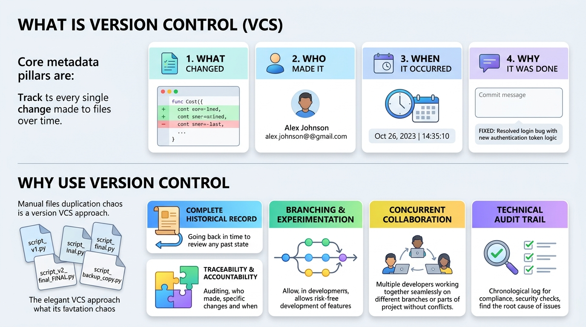
  <p><em>Figure 1.1: What is Version Control (What, Who, When, Why) and Why Use Version Control.</em></p>
</div>

---

### 1. What is Version Control?

A **Version Control System (VCS)** is a tool that tracks and manages every change made to computer files over time.

Whenever a change is recorded, the system saves an exact record of:
* **What changed:** Which exact lines were added, altered, or deleted.
* **Who made the change:** Author name and email.
* **When it occurred:** Date and timestamp.
* **Why it was done:** A mandatory commit message explaining the change.

---

### 2. Why Use Version Control?

Without version control, backups rely on duplicating files manually (e.g., `script_v1.py`, `script_final.py`). Version control eliminates this workflow by providing:

* **Complete Historical Record:** Reverts any file or entire project back to a prior state without losing progress.
* **Traceability and Accountability:** Pinpoints when an error was introduced, what caused it, and who committed it.
* **Branching & Experimentation:** Allows developers to test new features in isolated environments without risking production-ready code.
* **Concurrent Collaboration:** Enables multiple people to work on the exact same codebase simultaneously, merging modifications together programmatically.
* **Audit Trail & Documentation:** Creates an organized change log that serves as technical documentation for the codebase.

---

### 3. Git vs. Other Version Control Systems

Version control architectures fall into two primary models: **Centralized** and **Distributed**.

```
Centralized (CVCS):              Distributed (DVCS - Git):
   [ Central Server ]               [ Central / Remote ]
     /      |      \                   ^        ^
    v       v       v                  |        |
[Dev A]  [Dev B]  [Dev C]           [Dev A]  [Dev B]
(Working (Working (Working          (Full    (Full
 Copy)    Copy)    Copy)            Clone)   Clone)
```

<div align="center">
  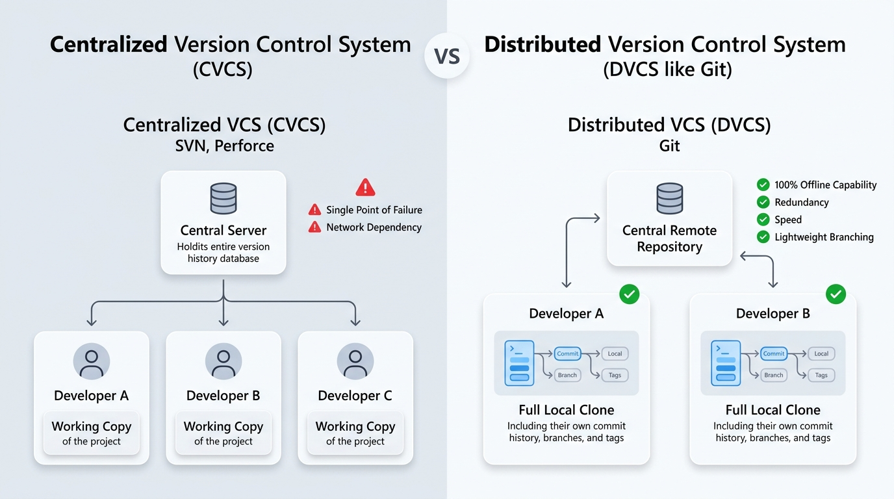
  <p><em>Figure 1.2: Architectural Comparison: Centralized VCS (SVN, Perforce) vs. Distributed VCS (Git).</em></p>
</div>

#### Centralized Version Control Systems (CVCS)
* **Examples:** SVN (Apache Subversion), CVS, Perforce.
* **Architecture:** A single central server houses the entire version history. Clients check out only a single snapshot of the files locally.
* **Limitations:**
  * **Single Point of Failure:** If the central server crashes or corrupts, history is lost unless external backups exist.
  * **Network Dependent:** Viewing commit history, creating branches, or saving versions requires an active network connection to the server.

#### Distributed Version Control Systems (DVCS)
* **Examples:** Git, Mercurial.
* **Architecture:** Every client clones the entire repository—including the full commit history, branches, and tags—directly onto their local storage.
* **Advantages of Git:**
  * **Offline Capability:** Commits, branches, diffs, and logs execute locally without network access.
  * **Redundancy:** Every developer's machine acts as a complete backup of the repository.
  * **Speed:** File operations happen on local disk storage rather than across a network.
  * **Branching Model:** Git’s branching system is lightweight and fast compared to older systems where branching required duplicating entire directories.

---

### 4. Practical Task: Installing Git Locally

Follow the instructions corresponding to your operating system to install Git and verify the setup.

#### Option A: Windows Installation

**Download the Official Installer:**
* Navigate to [https://git-scm.com/install/windows](https://git-scm.com/install/windows).
* Download the 64-bit Git for Windows Setup.

**Run the Setup Wizard:**
* **Default Editor:** When prompted to choose an editor, select **Visual Studio Code** (or your preferred editor).
* **Initial Branch Name:** Choose **"Override the default branch name for new repositories"** and set it to `main`.
* **PATH Environment:** Select **"Git from the command line and also from 3rd-party software"** (recommended).
* **Line Ending Conversions:** Select **"Checkout Windows-style, commit Unix-style line endings"** (`core.autocrlf = true`).
* **Terminal Emulator:** Choose **"Use MinTTY (the default terminal of MSYS2)"**.
* Leave remaining options at their default settings and click **Install**.

**Alternative via Windows Package Manager:**
```powershell
winget install --id Git.Git -e --source winget
```
*(After using winget, close and restart your terminal).*

#### Option B: macOS Installation
Choose one of the following methods:

**Method 1: Apple Developer Command Line Tools (Quickest)**
* Open Terminal (`Cmd + Space`, search `Terminal`).
* Run:
  ```bash
  xcode-select --install
  ```
* Click **Install** in the software update popup and accept the license.

**Method 2: Homebrew (Recommended for Latest Releases)**
* If Homebrew is installed, run:
  ```bash
  brew install git
  ```

#### Option C: Linux Installation
Open your terminal and run the commands for your distribution:

* **Debian / Ubuntu:**
  ```bash
  sudo apt update
  sudo apt install git -y
  ```
* **Fedora / RHEL / CentOS:**
  ```bash
  sudo dnf install git -y
  ```
* **Arch Linux:**
  ```bash
  sudo pacman -S git
  ```

---

### 5. Verifying the Installation

Once installation is complete, close any open terminal windows and open a new terminal session (Command Prompt/PowerShell on Windows, Terminal on macOS/Linux).

#### 1. Run the Version Verification Command:
```bash
git --version
```

**Expected Output:**
The command must output the installed version string without errors:
```plaintext
git version 2.x.x
```
*(Any version `2.x.x` confirms that Git is installed and available in your system's PATH).*

#### 2. Run the Help Command to Inspect Core Subcommands:
```bash
git --help
```
*(This confirms the Git executable is responsive and prints standard command-line options).*

<div align="center">
  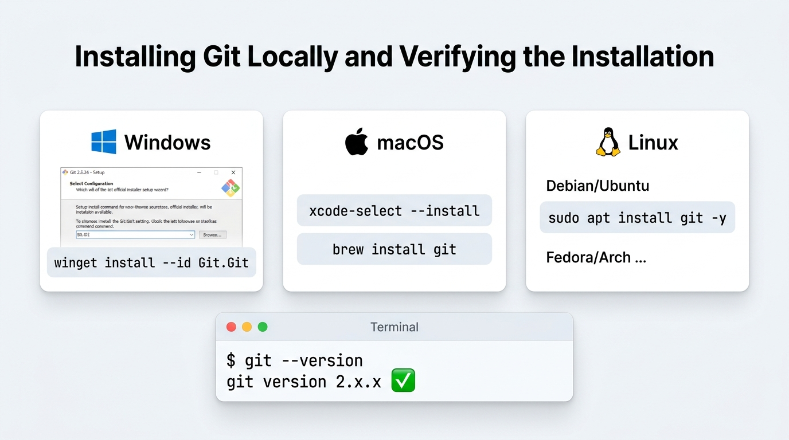
  <p><em>Figure 1.3: Cross-Platform Git Installation (Windows, macOS, Linux) and Terminal Verification.</em></p>
</div>

---

### 📋 Quick Reference Summary

| Concept | Definition |
| :--- | :--- |
| **VCS** | Software that records changes to a file or set of files over time. |
| **CVCS** | Centralized VCS; depends on a single server for full history. |
| **DVCS** | Distributed VCS; every client has a complete copy of repository history. |
| **Git** | An open-source, local distributed version control software. |
| **Verification Command** | `git --version` (used to verify successful installation). |

---

## ⚙️ Day 2: Git Configuration (git config, Local vs. Global)

> [!NOTE]
> Day 2 covers how Git embeds immutable author metadata into commit objects, how configuration scopes cascade from System to Global to Local, essential editor and newline configurations, and configuration inspection.

<div align="center">
  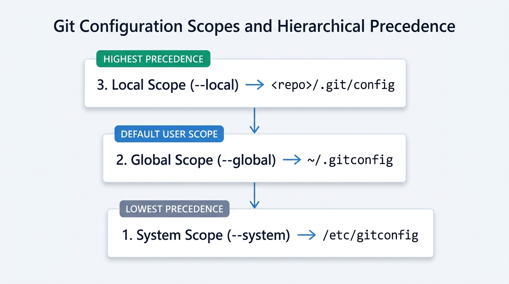
  <p><em>Figure 2.1: Git Configuration Scopes & Precedence Hierarchy (Local > Global > System).</em></p>
</div>

---

### 1. What is Git Configuration?

Git does not operate anonymously. Every time a change is saved (committed), Git permanently embeds cryptographic metadata into that commit:

* **The author's full display name:** The human-readable name of the engineer.
* **The author's email address:** The verified email address linked to your developer profile.
* **The exact timestamp:** The precise date, time, and timezone when the change was authored and committed.

Once written into a commit, this identity becomes an immutable part of the project's historical hash tree. Altering it later requires rewriting repository history.

The primary tool used to set, modify, and query these operational parameters is the `git config` command-line utility.

---

### 2. Configuration Scopes & Hierarchical Precedence

Git stores its settings across three distinct configuration levels (or scopes). Understanding these scopes prevents identity conflicts between personal projects and professional or educational repositories.

```
┌─────────────────────────────────────────────────────────────┐
│ 1. System Scope (--system)                                   │
│    Applies to all OS user accounts on this machine           │
└──────────────────────────────┬──────────────────────────────┘
                               │
                               ▼  (Overridden by)
┌─────────────────────────────────────────────────────────────┐
│ 2. Global Scope (--global)                                  │
│    Applies to the logged-in OS user across ALL repositories │
└──────────────────────────────┬──────────────────────────────┘
                               │
                               ▼  (Overridden by)
┌─────────────────────────────────────────────────────────────┐
│ 3. Local Scope (--local)                                    │
│    Applies ONLY to a specific repository (.git/config)      │
└─────────────────────────────────────────────────────────────┘
```

#### Detailed Breakdown of Scopes

| Scope Level | CLI Flag | File System Location | Typical Use Case |
| :--- | :--- | :--- | :--- |
| **System** | `--system` | **Unix/macOS:** `/etc/gitconfig`<br/>**Windows:** `C:\Program Files\Git\etc\gitconfig` | Applied across all user accounts on the physical computer. Rarely edited unless managing multi-user shared lab servers. |
| **Global** | `--global` | **Unix/macOS:** `~/.gitconfig` or `~/.config/git/config`<br/>**Windows:** `C:\Users\<Username>\.gitconfig` | General identity and baseline settings applied to every repository created or cloned by your computer profile. |
| **Local** | `--local` | `<Repository-Root>/.git/config` | Applied strictly inside one individual project folder. Used when a specific project requires an alternate email address or custom remote settings. |

#### Precedence Rule

If the exact same configuration variable is set at multiple levels, Git resolves settings in order of specificity:

> **Precedence Hierarchy:**  
> **Local** *(Highest Precedence)* ❯ **Global** *(User Default)* ❯ **System** *(Lowest Precedence)*

> **Important Detail:** If you execute `git config` inside an existing repository without supplying an explicit scope flag (such as `--global` or `--system`), Git defaults to `--local`. If executed outside of a repository without flags, Git throws a fatal error because no `.git/config` file exists to modify.

---

### 3. Configuring User Identity

#### Setting the Global Identity (Default Setup)
Run these commands in your terminal to set your baseline machine-wide developer identity:

```bash
git config --global user.name "Your Name"
git config --global user.email "your.email@example.com"
```

* **user.name:** Your professional name or public handle (e.g., Alex Morgan). It does not need to match your operating system account username.
* **user.email:** The email address where your contributions are credited. For GitHub integration, this should match the verified email address linked to your GitHub account (which will be configured on Day 5).

#### Setting a Local (Per-Repository) Identity
When contributing to an employer codebase, client project, or institutional assignment that mandates a specific work/school email address (e.g., `alex@university.edu`), navigate inside that repository's directory and execute:

```bash
git config --local user.name "Alex Morgan"
git config --local user.email "alex@university.edu"
```

* **Outcome:** Commits made inside this specific folder will use `alex@university.edu`, while every other repository on your machine continues to use `your.email@example.com` via the global configuration.

---

### 4. Essential Behavioral Configurations

Beyond name and email, production workflows rely on standard defaults for branch naming, text editors, line endings, and credentials.

<div align="center">
  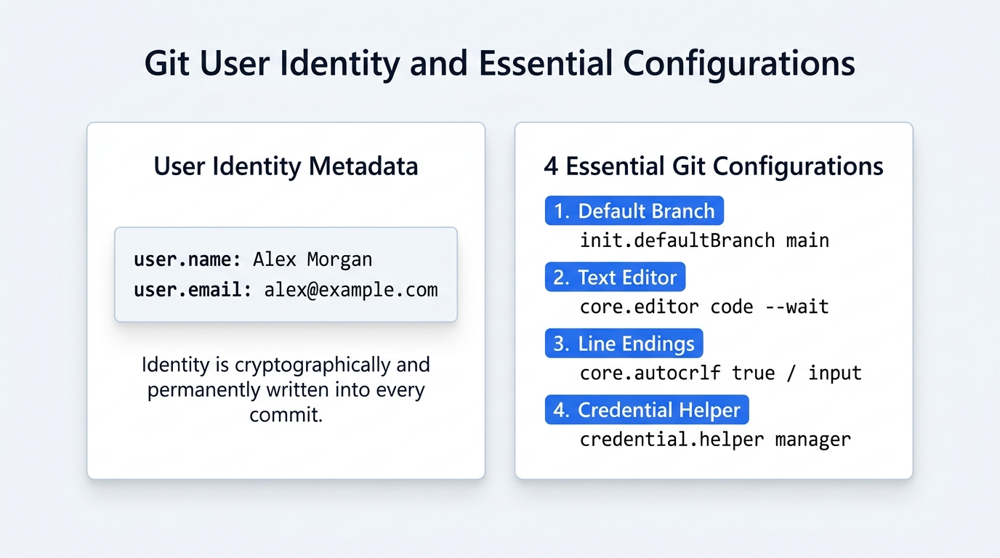
  <p><em>Figure 2.2: User Identity Metadata & 4 Essential Git Configurations.</em></p>
</div>

#### 1. Default Branch Initialization (`init.defaultBranch`)
Historically, Git defaulted initial branches to `master`. Modern Git distributions and hosting platforms (GitHub, GitLab) use `main` as the standard default branch name:

```bash
git config --global init.defaultBranch main
```

#### 2. Default Text Editor (`core.editor`)
Whenever Git requires an interactive message (such as merge conflict resolution, empty commit messages, or interactive rebasing), it invokes your system's default editor:

* **Visual Studio Code (GUI):**
  ```bash
  git config --global core.editor "code --wait"
  ```
  *(The `--wait` flag instructs your terminal to pause until you close the VS Code file tab).*
* **Nano (Beginner-friendly CLI):**
  ```bash
  git config --global core.editor "nano"
  ```
* **Vim (Advanced CLI):**
  ```bash
  git config --global core.editor "vim"
  ```

#### 3. Cross-Platform Line Endings (`core.autocrlf`)
Different operating systems represent newlines in text files using different ASCII control characters:
* **Windows:** Carriage Return + Line Feed (`CRLF`, `\r\n`).
* **macOS / Linux:** Line Feed (`LF`, `\n`).

If Windows and macOS/Linux developers collaborate on the same repository without normalizations, Git detects the invisible line-ending changes as complete file modifications, polluting the commit history.

* **On Windows Machines:**
  ```bash
  git config --global core.autocrlf true
  ```
  *(Converts LF to CRLF when checking out files to your disk, and converts CRLF back to LF when committing into the repository).*
* **On macOS and Linux Machines:**
  ```bash
  git config --global core.autocrlf input
  ```
  *(Maintains LF on disk and ensures any accidental CRLF introduced is stripped before being committed).*

#### 4. Credential Helper (`credential.helper`)
Prevents having to manually authenticate repeatedly when communicating with remote servers over HTTPS:

* **Windows:**
  ```bash
  git config --global credential.helper manager
  ```
* **macOS:**
  ```bash
  git config --global credential.helper osxkeychain
  ```
* **Linux:**
  ```bash
  git config --global credential.helper cache
  ```

---

### 5. Inspecting, Verifying & Debugging Configurations

#### Verifying Specific Configuration Keys
Query the current resolved value of any single variable:

```bash
git config user.name
git config user.email
```

#### Listing All Active Configurations
To print every configuration variable currently active in your environment:

```bash
git config --list
```

To restrict the list output to a single scope:

```bash
git config --list --global
git config --list --local
```

#### Tracing Configuration Sources (`--show-origin`)
When a setting is behaving unexpectedly, print the configuration values along with the exact physical file path where each setting is defined:

```bash
git config --list --show-origin
```

**Example Output:**
```
file:C:/Program Files/Git/etc/gitconfig    core.symlinks=false
file:C:/Program Files/Git/etc/gitconfig    core.autocrlf=true
file:C:/Users/Alex/.gitconfig              user.name=Alex Morgan
file:C:/Users/Alex/.gitconfig              user.email=alex@example.com
file:C:/Users/Alex/.gitconfig              init.defaultbranch=main
```

---

### 6. Modifying and Unsetting Configuration Values

#### Overwriting an Existing Setting
To update an existing variable, re-run the `git config` assignment with the new value. The old value is replaced automatically:

```bash
git config --global user.name "Alexander Morgan"
```

#### Removing a Variable (`--unset`)
If a value was entered incorrectly or needs to be cleared:

```bash
git config --global --unset user.name
```

#### Direct File Editing (`--edit`)
Git configuration files are standard INI-formatted text files. You can open and edit the configuration file directly inside your configured text editor:

```bash
git config --global --edit
```

**Sample Structure of `~/.gitconfig`:**
```ini
[user]
    name = Alex Morgan
    email = alex@example.com
[init]
    defaultBranch = main
[core]
    autocrlf = true
    editor = code --wait
```

---

### 7. Practical Task Walkthrough

Complete the following validation sequence in your terminal to fulfill the Day 2 practical assignment:

```bash
# Step 1: Set your global name
git config --global user.name "Your Preferred Name"

# Step 2: Set your global email
git config --global user.email "yourname@example.com"

# Step 3: Set your default branch to main
git config --global init.defaultBranch main

# Step 4: Configure line-ending behavior (run the one matching your OS)
# For Windows:
git config --global core.autocrlf true
# For macOS / Linux:
git config --global core.autocrlf input

# Step 5: Verify the values
git config user.name
git config user.email

# Step 6: Print configuration origins to confirm the file location
git config --list --show-origin
```

---

### 📋 Quick Reference Summary

| Command | Description |
| :--- | :--- |
| `git config --global user.name "Name"` | Sets the system user's default commit author name. |
| `git config --global user.email "Email"` | Sets the system user's default commit author email. |
| `git config --local user.email "Email"` | Overrides the commit email strictly within the current repository. |
| `git config --global init.defaultBranch main` | Configures new local repositories to initialize on `main`. |
| `git config --global core.autocrlf true/input` | Configures line-ending normalization across operating systems. |
| `git config --list` | Dumps all active configuration keys and values. |
| `git config --list --show-origin` | Displays every active configuration setting alongside its physical file path. |
| `git config --global --unset <key>` | Removes a configuration entry from the global scope. |
| `git config --global --edit` | Opens the global `.gitconfig` file in your text editor. |

---

## 📦 Day 3: Repository Basics & The Three Trees (git init, .git Anatomy)

> [!NOTE]
> Day 3 covers the core internal architecture of Git: standard directories vs Git repositories, the Three-Stage Tree workflow (Working Directory, Staging Area, Local Repository), file lifecycles, and the internal anatomy of the `.git` folder.

<div align="center">
  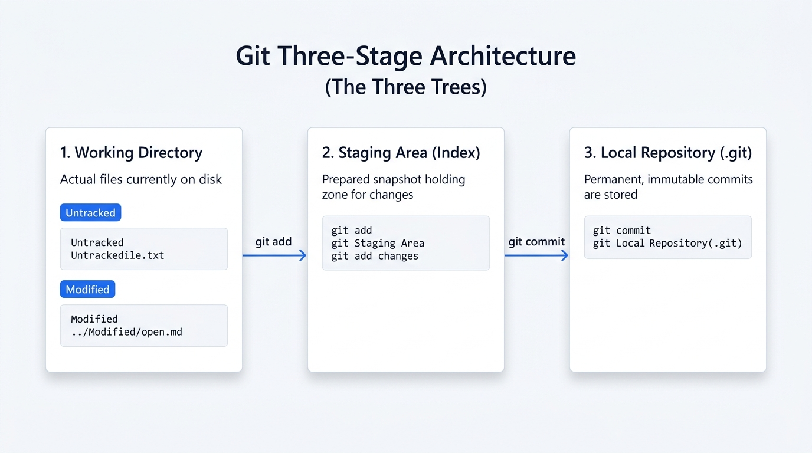
  <p><em>Figure 3.1: The Three Trees: Working Directory, Staging Area (Index), and Local Repository (.git).</em></p>
</div>

---

### 1. What is a Git Repository?

A **Git Repository** (often shortened to **Repo**) is a filesystem directory that Git actively monitors for modifications.

* **Standard Directory:** A regular folder managed purely by your operating system. Any modification or deletion overwrites the disk state with zero historical record or recovery capability.
* **Git Repository:** A standard directory containing an invisible, internal subfolder named `.git`. The presence of this `.git` directory turns a basic folder into a fully tracked repository capable of taking historical snapshots (commits).

---

### 2. Git's Three-Stage Architecture (The "Three Trees")

Git does not directly take a snapshot of your files the second you save them in an editor. Instead, Git manages files across three distinct states or areas before recording them permanently into history:

```
  Working Directory               Staging Area (Index)             Local Repository (.git)
┌───────────────────────┐       ┌───────────────────────┐       ┌───────────────────────┐
│                       │       │                       │       │                       │
│  Actual files on disk │ ────> │  Staged snapshot      │ ────> │  Permanent commits    │
│  (Untracked/Modified) │  git  │  (Prepared changes)   │  git  │  (Immutable history)  │
│                       │  add  │                       │ commit│                       │
└───────────────────────┘       └───────────────────────┘       └───────────────────────┘
```

#### The Three Areas Explained

| Area | Technical Name | What Lives Here | Purpose |
| :--- | :--- | :--- | :--- |
| **1. Working Directory** | Working Tree | The visible files and folders sitting on your local storage drive. | Where you edit, create, and delete code using your text editor or IDE. |
| **2. Staging Area** | The Index / Cache | A binary staging file located at `.git/index`. | A preparation holding zone where you pick and choose exactly which modified lines or files belong in the next snapshot. |
| **3. Local Repository** | Git Directory (`.git`) | The internal database containing all project history and metadata. | The permanent storage archive where finished commits are recorded indefinitely. |

> **Key Architectural Insight:** The Staging Area gives you surgical precision over your commits. If you edited 5 files today, you do not have to commit them all at once. You can stage 2 files for a bug fix commit, and stage the other 3 files separately for a feature commit.

---

### 3. The Lifecycle of a File in Git

Inside your repository, every file exists in one of two major states: **Untracked** or **Tracked**.

```
              ┌─────────────── UNTRACKED (File newly created)
              │                       │
              │                       │ git add
              ▼                       ▼
┌─────────────────────────────────────────────────────────────┐
│                       TRACKED FILES                         │
│                                                             │
│   ┌──────────────┐     Edit file      ┌──────────────┐      │
│   │  Unmodified  │ ─────────────────> │   Modified   │      │
│   └──────────────┘                    └──────────────┘      │
│          ▲                                   │              │
│          │ git commit                        │ git add      │
│          │                                   ▼              │
│   ┌──────────────────────────────────────────────────┐      │
│   │                 Staged / Indexed                 │      │
│   └──────────────────────────────────────────────────┘      │
└─────────────────────────────────────────────────────────────┘
```

#### Detailed File States

* **Untracked:** Any file present in the directory that Git has never seen before and is not yet part of any snapshot. Git explicitly ignores untracked files until told to include them.
* **Tracked:** Files that were included in the previous snapshot. They can be:
  * **Unmodified:** The file is identical to what is stored in the last commit.
  * **Modified:** The file has been edited in the working directory since the last commit, but has not yet been staged.
  * **Staged:** A modified or newly created file marked to go into the next commit snapshot.

---

### 4. Repository Initialization: `git init`

To turn an existing folder into a tracked repository, you initialize it using the `git init` command:

```bash
git init
```

#### What Happens Behind the Scenes?

Running `git init` creates a hidden subfolder named `.git` at the root of your project directory:

* It **does not alter, move, or overwrite** any of your existing code files.
* It sets up the default tracking branch (configured as `main` on Day 2).
* **Destruction Warning:** If you delete the `.git` folder, your project reverts to a standard unversioned folder, and all commit history and branches are permanently erased.

---

### 5. Inspecting the Hidden `.git` Directory

Because `.git` starts with a period (`.`), it is hidden by operating system file explorers by default to prevent accidental deletion.

<div align="center">
  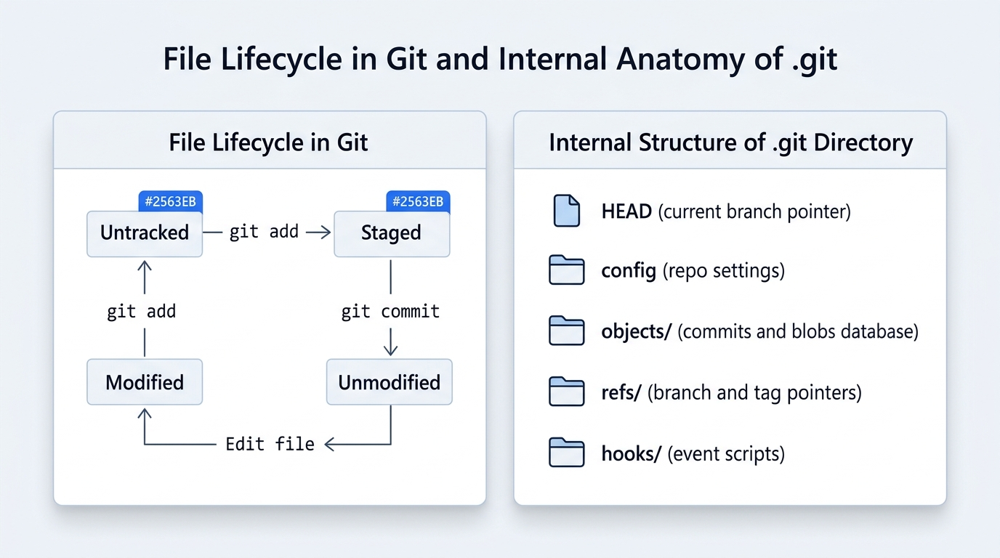
  <p><em>Figure 3.2: File State Transitions and Core Database Components inside .git.</em></p>
</div>

#### Internal Structure of the `.git` Directory

When inspected, the initialized `.git` directory contains the following core files and folders:

```plaintext
.git/
├── HEAD             # Points to the branch currently checked out (e.g., ref: refs/heads/main)
├── config           # Repository-specific local configuration settings
├── description      # Used primarily by GitWeb (default description file)
├── hooks/           # Sample client/server scripts triggered before or after Git actions
├── info/            # Global exclusion file (exclude patterns for this specific repo)
├── objects/         # The object database (stores blobs, trees, commits, and tags)
└── refs/            # Pointers to commit objects (heads, tags, remotes)
    ├── heads/       # Local branch pointers (e.g., main, feature/login)
    └── tags/        # Release tags (e.g., v1.0.0)
```

---

### 6. Practical Task Walkthrough

Follow these terminal steps to create a practice repository, initialize tracking, and inspect the internal file structure:

#### Step 1: Create a Dedicated Directory & Enter It

```bash
# Navigate to your workspace (e.g., Desktop or Projects)
cd Desktop

# Create a new directory for today's exercise
mkdir day3-repo-practice

# Step inside the newly created directory
cd day3-repo-practice
```

#### Step 2: Initialize the Repository
Run the initialization command inside the directory:

```bash
git init
```

**Expected Terminal Output:**
```plaintext
Initialized empty Git repository in /Users/<Username>/Desktop/day3-repo-practice/.git/
```

#### Step 3: Inspect the Filesystem for Hidden Contents
List all directory contents, including hidden files and flags:

* **On macOS / Linux / Git Bash:**
  ```bash
  ls -la
  ```
* **On Windows PowerShell:**
  ```powershell
  Get-ChildItem -Force
  ```

**Expected Terminal Output:**
```plaintext
drwxr-xr-x   .
drwxr-xr-x   ..
drwxr-xr-x   .git
```

#### Step 4: Inspect the Internal Contents of the `.git` Folder
List the components created inside the internal metadata folder:

* **On macOS / Linux / Git Bash:**
  ```bash
  ls -la .git
  ```
* **On Windows PowerShell:**
  ```powershell
  Get-ChildItem -Force .git
  ```

#### Step 5: Check Repository Status
Check the current state of the working directory and staging area:

```bash
git status
```

**Expected Terminal Output:**
```plaintext
On branch main

No commits yet

nothing to commit (create/copy files and use "git add" to track)
```

---

### 📋 Quick Reference Summary

| Concept / Command | Purpose |
| :--- | :--- |
| **Working Directory** | The folder containing visible files you directly edit on disk. |
| **Staging Area (Index)** | The intermediary zone where changes are organized before committing. |
| **Local Repository** | The internal `.git` database holding permanent snapshot records. |
| **`git init`** | Initializes a new local Git repository in the current directory. |
| **`git status`** | Displays active branch, untracked files, and staged changes. |
| **`.git` folder** | The hidden folder housing all version history, objects, and configs. |

---

## ⚡ Day 4: Basic Git Commands (git add, git commit, git log, .gitignore)

> [!NOTE]
> According to your 30-Day Roadmap, Day 4 transitions from passive repository inspection to recording snapshots and managing file tracking:
> - **Learning Module:** Basic Git Commands
> - **Topics to Cover:** `git add`, `git commit`, viewing commit history (`git log`), `.gitignore`
> - **Practical Task:** Make commits and ignore unnecessary files

<div align="center">
  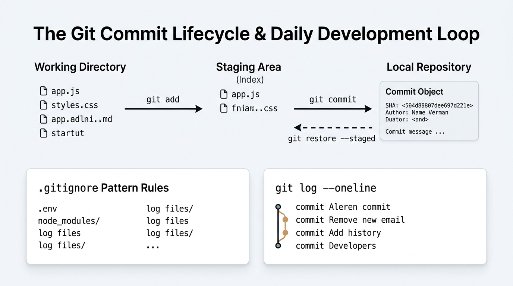
  <p><em>Figure 4.1: The Git Commit Lifecycle: Working Directory, Staging Area (Index), and Local Repo Commit Object.</em></p>
</div>

---

### 1. The Core Lifecycle of a Commit

In Git, saving changes is an explicit two-step operation:

* **Staging (`git add`):** Selecting exactly which modified or new files belong in the upcoming milestone snapshot.
* **Committing (`git commit`):** Freezing that staged bundle into an immutable, cryptographically hashed record in the repository's permanent history.

```
Working Directory               Staging Area (Index)              Local Repo (Commit Object)
┌──────────────────────┐        ┌──────────────────────┐        ┌───────────────────────────────┐
│ Edit/Create files    │        │ Staged files ready   │        │ Permanent Snapshot            │
│ app.py, notes.txt    │ ─────> │ for inclusion        │ ─────> │ SHA: 7b3e9a1                  │
│                      │ git add│ app.py               │ git    │ Author, Timestamp, Message    │
└──────────────────────┘        └──────────────────────┘ commit └───────────────────────────────┘
```

---

### 2. Staging Files with `git add`

The `git add` command moves changes from the Working Directory to the Staging Area (also referred to as the Index).

#### Essential Staging Commands:
* **Stage a specific file:**
  ```bash
  git add <filename>
  ```
* **Stage multiple specific files:**
  ```bash
  git add app.js styles.css index.html
  ```
* **Stage all changes across the repository (new, modified, and deleted files):**
  ```bash
  git add .
  ```
  *(Or: `git add -A` / `git add --all`)*
* **Interactive staging (stage partial hunks/lines of code within a file):**
  ```bash
  git add -p <filename>
  ```

#### Unstaging Files
If a file was staged accidentally, pull it back to the Working Directory without discarding your written code:
```bash
git restore --staged <filename>
```
*(Legacy syntax: `git reset HEAD <filename>`)*

---

### 3. Creating Snapshots with `git commit`

A commit is an immutable point-in-time snapshot of the staged files. Every commit generates a unique 40-character SHA-1 hash (or SHA-256 in modern setups) containing author metadata, the parent commit reference, and the tree structure.

#### Standard Inline Commit:
```bash
git commit -m "feat: implement user authentication flow"
```

#### Writing Detailed Multi-Line Commit Messages
Executing `git commit` without the `-m` flag opens your configured text editor (e.g., VS Code or Nano) to write a detailed log:

```bash
git commit
```

**Standard Commit Format:**
```plaintext
Short summary (50 characters or less)

More detailed explanatory text wrapping at 72 characters.
Explain the problem this commit solves, why the change was made,
and any side effects or gotchas.

- Bullet points are acceptable
- Closes #104
```

#### Staging and Committing Tracked Files Simultaneously (`-am`)
To stage all modified tracked files and commit them in a single command:
```bash
git commit -am "fix: correct typo in hero banner"
```

> **Notice:** The `-am` shortcut does not pick up newly created untracked files. New files must first be staged with `git add <filename>`.

---

### 4. Inspecting History with `git log`

The `git log` command prints the repository's chronological commit history starting from the most recent commit back to the initial root commit.

| Command Flag | Output Style / Purpose |
| :--- | :--- |
| `git log` | Default view: 40-character SHA, Author, Date, and full message. |
| `git log --oneline` | Compact view: 7-character abbreviated hash and commit title. |
| `git log -n <number>` | Limits output to the last N commits (e.g., `git log -n 3` or `git log -3`). |
| `git log --stat` | Displays file modification stats along with additions (+) and deletions (-). |
| `git log -p` | Shows the patch diff (exact line additions and deletions) for each commit. |
| `git log --graph --oneline --all` | ASCII graph displaying branch divergence, merges, and topology. |

#### Navigating the Git Pager
When logs exceed the terminal window, Git opens a terminal pager (usually `less`):
* **Down Arrow / j:** Scroll down one line.
* **Up Arrow / k:** Scroll up one line.
* **Spacebar:** Scroll down one full page.
* **q:** Exit the log viewer and return to the prompt.

---

### 5. Ignoring Files with `.gitignore`

A `.gitignore` file is a plain-text configuration file placed in the repository root that directs Git to disregard untracked files and directories so they never show up under `git status` or get committed.

#### Primary Use Cases:
* **Security:** Prevents committing secrets, access tokens, and environment configurations (`.env`).
* **Noise Reduction:** Excludes build artifacts, machine caches (`__pycache__`), and compiled binaries (`.class`, `.o`).
* **Repository Bloat:** Excludes third-party package dependencies (`node_modules/`, `.venv/`).

#### Pattern Syntax & Matching Rules:
```gitignore
# 1. Ignore a specific file
.env
secret_key.pem

# 2. Wildcard pattern to ignore files by extension
*.log
*.tmp
*.bak

# 3. Ignore an entire directory (must end with a slash /)
node_modules/
dist/
build/
.venv/

# 4. Negation rule (track this file even if the extension rule matches)
!important.log

# 5. Wildcard pattern for directory sub-paths
**/cache/
```

#### Handling Previously Committed Files
`.gitignore` only affects untracked files. If a sensitive or unwanted file was already committed previously, adding it to `.gitignore` will not remove it from Git's tracking tree. You must remove it from the staging index while retaining it on your physical drive:
```bash
git rm --cached <filename>
git commit -m "chore: remove tracked file from index"
```

---

### 6. Hands-On Practical Task Walkthrough

#### Step 1: Navigate to Your Practice Repository
```bash
cd day3-repo-practice
git status
```

#### Step 2: Create Project Source Files
```bash
touch app.js styles.css
```

#### Step 3: Stage and Commit the New Files
```bash
# Stage the files
git add app.js styles.css

# Verify they appear green under 'Changes to be committed'
git status

# Record the snapshot
git commit -m "feat: initialize app and stylesheet"
```

#### Step 4: Create Files That Should Be Excluded
```bash
touch .env app.log
```
Run `git status` to see `.env` and `app.log` listed in red under Untracked files.

#### Step 5: Configure `.gitignore`
```bash
# Append rules to .gitignore
echo ".env" >> .gitignore
echo "*.log" >> .gitignore

# Verify status
git status
```
**Expected Result:** `.env` and `app.log` disappear completely from the untracked file list. Only `.gitignore` appears as an untracked file.

#### Step 6: Commit the `.gitignore` File
```bash
git add .gitignore
git commit -m "chore: configure .gitignore to exclude env and log files"
```

#### Step 7: Inspect History
```bash
git log --oneline
```
**Expected Output:**
```plaintext
a1b2c3d chore: configure .gitignore to exclude env and log files
e4f5g6h feat: initialize app and stylesheet
```

---

### 📋 Quick Reference Summary

| Command / Syntax | Action |
| :--- | :--- |
| `git add <file>` | Moves specific changes from Working Directory to Staging Area. |
| `git add .` | Stages all current additions, modifications, and deletions. |
| `git commit -m "<msg>"` | Records staged snapshot into permanent repository history. |
| `git commit -am "<msg>"` | Stages tracked changes and commits them in one step. |
| `git restore --staged <file>` | Removes a staged file from the Index back to Working Directory. |
| `git log --oneline` | Displays compact, single-line commit history with abbreviated hashes. |
| `git log --stat` | Lists historical commits alongside file modification metrics. |
| `.gitignore` | Configuration file specifying untracked file patterns Git must ignore. |
| `git rm --cached <file>` | Untracks a file from Git without deleting it from physical storage. |

---

## 🌐 Day 5: GitHub Essentials (Account, Interface, Profile & Profile README)

> [!NOTE]
> Day 5 shifts focus from local Git operations to GitHub's remote collaboration platform:
> - **Learning Module:** GitHub Essentials
> - **Topics to Cover:** Creating a GitHub account, GitHub interface navigation, profile setup, profile README
> - **Practical Task:** Set up your GitHub profile with MSC PRPCEM standards

---

### 1. What is GitHub & Why Does It Matter?

While Git runs locally on your machine without an internet connection, GitHub is a cloud-hosted platform built around Git. It serves three primary functions:

* **Remote Repository Host:** Acts as a centralized off-site backup for your local Git repositories.
* **Collaboration & Review Platform:** Provides code review tools (Pull Requests), task tracking (Issues, Projects), and discussion forums.
* **Developer Portfolio:** Functions as a public technical identity showcasing open-source contributions, code quality, and consistency via the contribution heatmap.

<div align="center">
  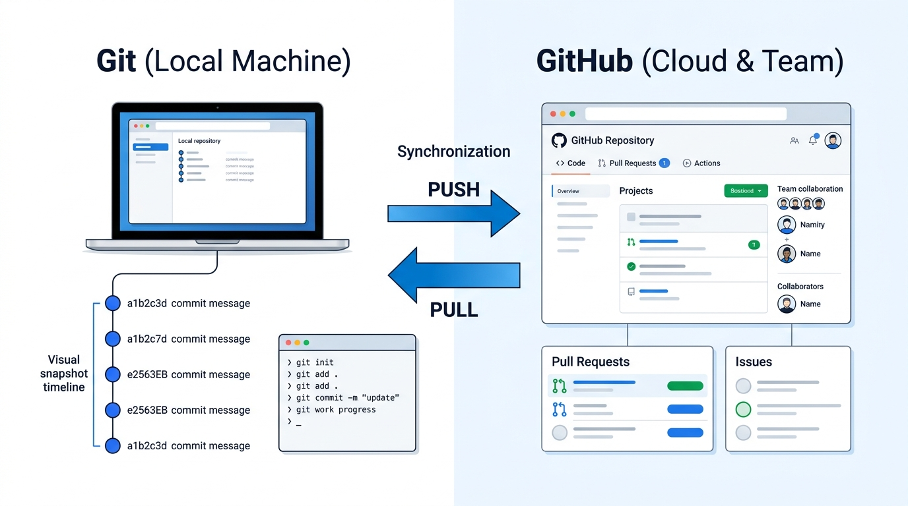
  <p><em>Figure 5.1: Git (Local Machine) vs. GitHub (Cloud & Team Collaboration with Push and Pull).</em></p>
</div>

---

### 2. Account Creation & Security Essentials

* **Navigate to GitHub:** Go to [github.com](https://github.com/) and sign up.
* **Username Selection:** Choose a clean, professional handle (e.g., `firstname-lastname`, `alex-dev`, or institutional handles like `mscprpcem`). This handle forms your permanent URL: `https://github.com/<username>`.
* **Primary Email:** Use the exact email address configured locally during Day 2 (`git config --global user.email "msc@prpcem.ac.in"`). GitHub uses this email address to link your local commit hashes to your online GitHub account.
* **Two-Factor Authentication (2FA):** GitHub mandates 2FA for all active contributors. Enable it under **Settings > Password and authentication** using a mobile authenticator app (such as Google Authenticator, 1Password, or Microsoft Authenticator) and save your backup recovery codes securely.

---

### 3. GitHub Web Interface Navigation

When logged in, GitHub is organized into two primary scopes: the **Global Dashboard** and the **User Profile**.

```
┌─────────────────────────────────────────────────────────────────────────────┐
│ Top Nav: [Search or jump to...] [Pull requests] [Issues] [Codespaces] [🔔] [Avatar]│
├───────────────────────────────┬─────────────────────────────────────────────┤
│ Left Column:                  │ Center Feed:                                │
│ • Top Repositories            │ • Activity feed of followed developers/repos│
│ • "New" Repo Button           │ • Release updates, stars, and recommendations│
│ • Recent projects             │                                             │
└───────────────────────────────┴─────────────────────────────────────────────┘
```

<div align="center">
  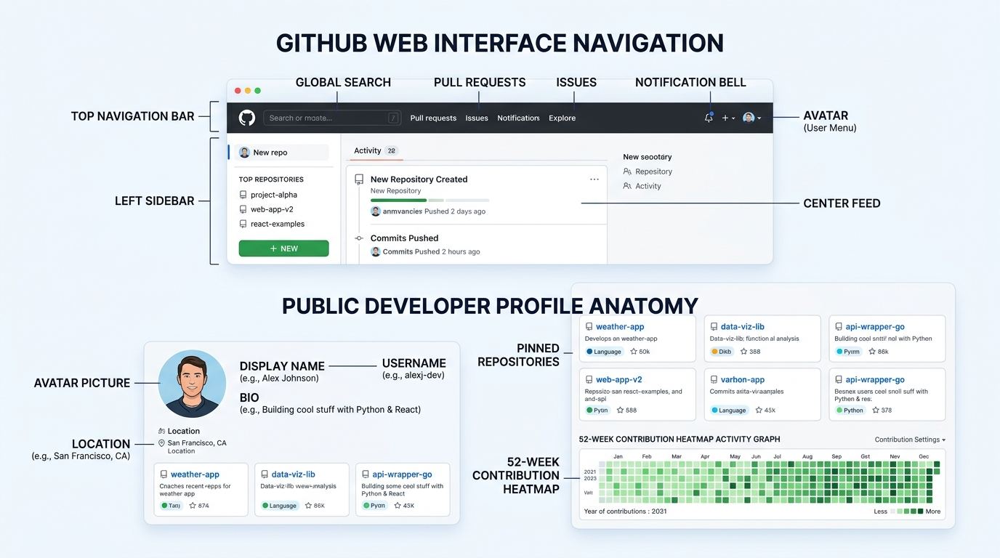
  <p><em>Figure 5.2: GitHub Web Interface Navigation & Public Developer Profile Anatomy.</em></p>
</div>

#### Core Interface Terminology
* **Global Search (`/` shortcut):** Allows searching across repositories, code snippets, commits, issues, and users.
* **Notification Inbox (`🔔`):** Aggregates mentions (`@mscprpcem`), review requests, CI/CD pipeline failures, and thread assignments.
* **Command Palette (`Ctrl+K` or `Cmd+K`):** Fast navigation across organizations, repositories, settings, and pull requests.

---

### 4. Customizing Your Public Profile (MSC PRPCEM Example)

Your public profile (`https://github.com/mscprpcem`) introduces you to recruiters, hiring managers, and open-source collaborators worldwide.

<div align="center">
  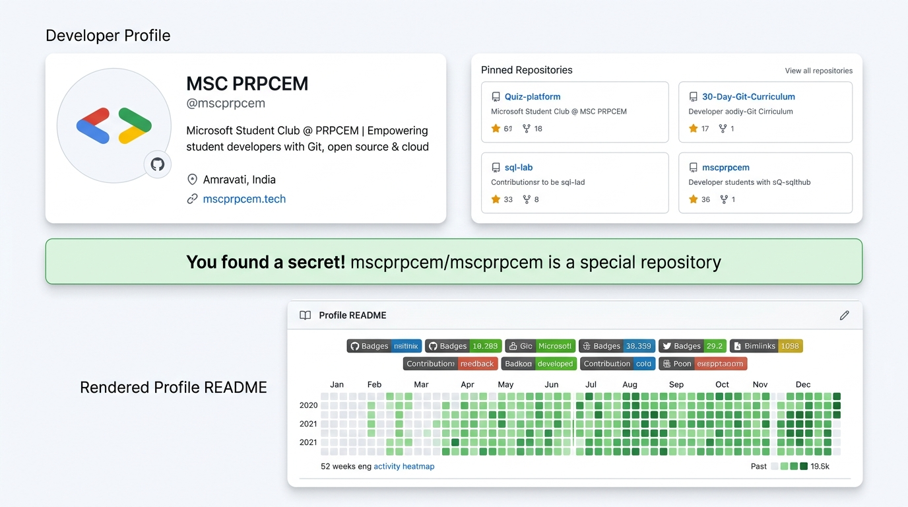
  <p><em>Figure 5.3: MSC PRPCEM Developer Profile, Pinned Repositories, Secret Repository Banner & Heatmap.</em></p>
</div>

#### Profile Components
* **Avatar & Profile Picture:** Official club emblem or clean personal professional photo.
* **Name & Pronouns:** `MSC PRPCEM (Microsoft Student Club)` or your real name.
* **Bio:** e.g., *"Microsoft Student Club @ PRPCEM | Empowering student developers with Git, open source & cloud."* (up to 160 characters).
* **Location & Time Zone:** `Amravati, Maharashtra, India`. Helps international open-source teams coordinate review times.
* **Website / Social Links:** `https://mscprpcem.tech` and `https://linkedin.com/company/mscprpcem`.
* **Pinned Repositories:** Up to 6 public repositories to highlight your best work (e.g., `Quiz-platform`, `30-Day-Git-Curriculum`, `sql-lab`).
* **Contribution Heatmap (Activity Graph):** A visual grid documenting commits, opened PRs, and issues over the past 52 weeks in green squares.

---

### 5. The Special "Profile README" (Secret Repository)

GitHub has a feature that allows you to display custom Markdown content directly at the top of your personal profile page.

<div align="center">
  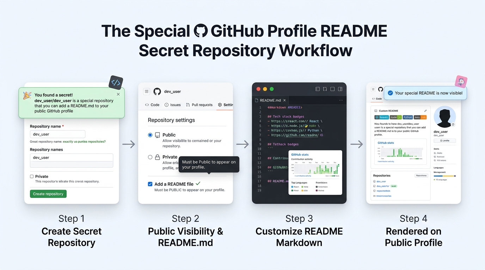
  <p><em>Figure 5.4: The Special Profile README 4-Step Setup Workflow (mscprpcem/mscprpcem).</em></p>
</div>

#### The 4 Strict Requirements for a Profile README
GitHub triggers the profile README card only if all four conditions are met:
1. **The repository name matches your GitHub username exactly (case-sensitive)** (e.g., username `mscprpcem` requires repo `mscprpcem`).
2. **The repository visibility is set to Public** (it will not display if set to Private).
3. **The root of the repository contains a file named `README.md`**.
4. **The `README.md` file contains text content**.

*(When creating this repository on GitHub, a special banner will appear: "You found a secret! mscprpcem/mscprpcem is a special repository that you can use to add a README.md to your GitHub profile.")*

---

### 6. Markdown Essentials for Profile READMEs

Markdown (`.md`) is the standard formatting language for GitHub documentation.

| Markdown Syntax | Rendered Output | Use Case |
| :--- | :--- | :--- |
| `# Heading 1` | Main page title | Primary title / greeting |
| `## Heading 2` | Section subtitle | Major sections (About Me, Tech Stack) |
| `### Heading 3` | Sub-section header | Section sub-groupings |
| `**Bold text**` | **Bold text** | Emphasizing key tools or achievements |
| `*Italic text*` | *Italic text* | Subtle notes or quotes |
| `[Link text](https://url.com)` | [Link text](https://url.com/) | Portfolio, LinkedIn, and social links |
| `- Item` or `* Item` | Bulleted list item | Tech stack and project highlights |
| `1. First item` | Numbered list item | Ordered accomplishments or goals |
| `` `inline code` `` | Code styling block | Tools, package names, command tags |
| `- [x] Task complete` | Checked interactive checkbox | Completed roadmap milestones |
| `- [ ] Task incomplete` | Unchecked checkbox | In-progress learning goals |
| `> Quoted note` | Blockquote callout box | Developer motto or featured quote |

---

### 7. Practical Task Walkthrough: Step-by-Step (MSC PRPCEM Example)

#### Step 1: Complete Account Metadata
1. Click your profile avatar in the upper right corner > **Settings**.
2. Under **Public profile**, configure:
   * **Name:** `MSC PRPCEM (Microsoft Student Club)`
   * **Bio:** *"Microsoft Student Club @ PRPCEM | Empowering student developers through Git, GitHub, open source & software engineering."*
   * **Location & URL:** Add `Amravati, Maharashtra, India` and `https://mscprpcem.tech`.
3. Click **Update profile**.

#### Step 2: Create the Special Profile Repository
1. In the upper right corner, click the **`+`** icon > select **New repository**.
2. In the **Repository name** input box, enter your exact GitHub handle: `mscprpcem`.
3. Verify that the special green box appears stating: *"You found a secret! mscprpcem/mscprpcem is a special repository that you can use to add a README.md to your GitHub profile."*
4. Ensure **Public** is selected.
5. Check the box **"Add a README file"**.
6. Click **Create repository**.

#### Step 3: Edit and Customize Your README.md
Click the pencil icon (**Edit**) on the `README.md` file inside the repository and paste the following official template:

```markdown
# Hi there, we are MSC PRPCEM 👋

<p align="left">
  
  
  
</p>

### 👨‍💻 About MSC PRPCEM
- 🔭 **What we're building:** Open-source projects, coding platforms, interactive technical workshops, and student mentorship programs.
- 🎯 **30-Day Goal:** Master Git & GitHub collaborative workflows across the PRPCEM engineering cohort.
- 💬 **Ask us about:** Web Development, Cloud Computing, Git/GitHub, SQL, and Community Hackathons.
- 🌐 **Official Portal:** [mscprpcem.tech](https://mscprpcem.tech)
- 📫 **Contact & Socials:** [LinkedIn](https://linkedin.com/company/mscprpcem) | [msc@prpcem.ac.in](mailto:msc@prpcem.ac.in)

---

### 🛠️ Tech Stack & Ecosystem
- **Version Control:** Git, GitHub, GitHub Actions, GitHub Pages
- **Frontend & Backend:** React, Node.js, Express, TailwindCSS, PostgreSQL, SQLite
- **Tools & Environments:** VS Code, Git Bash, Terminal, Docker

---

### 📈 GitHub Community & Contributor Stats


```

#### Step 4: Commit Changes & Verify Profile
1. Scroll down to the bottom of the editor.
2. In the commit message box, enter: `docs: initialize custom profile README`.
3. Select **Commit changes**.
4. Navigate to `https://github.com/mscprpcem`. Your custom profile README is now displayed at the top of your landing page!

---

### 📋 Quick Reference Summary

| Feature / Concept | Rule / Behavior | MSC PRPCEM Reference |
| :--- | :--- | :--- |
| **Email Attribution** | GitHub profile email must match `git config user.email` to credit commits. | `msc@prpcem.ac.in` |
| **Special Repo Name** | Must be `<username>/<username>` to render on your profile. | `mscprpcem/mscprpcem` |
| **Visibility Requirement** | Must be Public; setting it to Private immediately hides the profile README. | Public |
| **Pinned Items** | Maximum of 6 items (Repositories or Gists) can be pinned to the profile. | `Quiz-platform`, `30-Day-Git-Curriculum` |
| **Contribution Graph** | Tracks commits to default/gh-pages branches, opening PRs, and filing issues. | 52-week green activity heatmap |
| **Profile URL** | Permanent public portfolio address. | `https://github.com/mscprpcem` |

---

## 📚 Detailed Weekly Breakdown

### 🎯 Week 1: Git & GitHub Foundations (Days 1–7)
Focus: Understanding how Git models snapshots, setting up local and remote environments, making commits, and connecting to GitHub.

- **Day 1: Version Control Fundamentals**
  - *Topics*: What is version control, why use it, Git vs other VCS (SVN, Mercurial), installing Git locally.
  - *Practical*: Install Git (`git --version`) and verify terminal access.
- **Day 2: Git Configuration**
  - *Topics*: `git config`, local vs global configuration, system defaults.
  - *Practical*: Run `git config --global user.name "Your Name"` and `git config --global user.email "you@domain.com"`.
- **Day 3: Repository Basics**
  - *Topics*: Repository initialization, `git init`, working directory, staging area (index), `.git` anatomy.
  - *Practical*: Initialize a repository with `git init` and inspect hidden `.git` files.
- **Day 4: Basic Git Commands**
  - *Topics*: `git status`, `git add`, `git commit -m`, inspecting log history, configuring `.gitignore`.
  - *Practical*: Stage files, craft atomic commits, and ignore build directories/environment files.
- **Day 5: GitHub Essentials**
  - *Topics*: Creating a GitHub account, interface navigation, profile setup, profile README (`username/username`).
  - *Practical*: Create your special GitHub profile repository with Markdown bio and badges.
- **Day 6: Repositories & Documentation**
  - *Topics*: Creating public vs private repositories, writing Markdown, README structure, Conventional Commit messages.
  - *Practical*: Create a repository with a structured `README.md` and license.
- **Day 7: Git Remotes**
  - *Topics*: Remote repositories, `git remote add`, `git push -u`, `git pull`, fetching changes without merging (`git fetch`).
  - *Practical*: Connect your local repository to a remote GitHub repository and push your `main` branch.

---

### 🌿 Week 2: Branching, Merging & History (Days 8–14)
Focus: Branch management, merging strategies, resolving conflicts, and team collaboration workflows.

- **Day 8: Branching Basics**
  - *Topics*: Creating, renaming, deleting, and switching branches (`git branch`, `git switch`, `git checkout -b`).
  - *Practical*: Create a feature branch `feature/navbar`, add changes, and switch between branches.
- **Day 9: Merging & Collaboration**
  - *Topics*: Merging fundamentals, Fast-Forward merges vs 3-Way merge commits (`--no-ff`), merge strategies.
  - *Practical*: Merge a completed feature branch into the `main` branch.
- **Day 10: Conflict Resolution**
  - *Topics*: Understanding merge conflicts, conflict markers (`<<<<<<<`, `=======`, `>>>>>>>`), resolving and committing.
  - *Practical*: Intentionally create a merge conflict on the same line across two branches, resolve it, and verify changes.
- **Day 11: Advanced Branch Collaboration**
  - *Topics*: Forking vs cloning, upstream remotes, adding collaborators, open-source contribution cycle.
  - *Practical*: Fork an open-source repository and submit a pull request.
- **Day 12: Pull Request Workflow**
  - *Topics*: PR guidelines, code review etiquette, branch naming conventions, contribution guidelines (`CONTRIBUTING.md`).
  - *Practical*: Open a pull request with a descriptive summary, issue link, and screenshots.
- **Day 13: GitHub Issues**
  - *Topics*: Issue tracking, issue templates, labels (bug, enhancement), milestone assignments, saved replies, cross-linking.
  - *Practical*: Create an issue reporting a bug or requesting a feature with markdown checkboxes.
- **Day 14: GitHub Collaboration**
  - *Topics*: GitHub Discussions, GitHub Wikis, architectural documentation, and `CITATION.cff` files.
  - *Practical*: Document repository usage in a GitHub Wiki or GitHub Discussion thread.

---

### 🧰 Week 3: Stashing, Undoing & Advanced Team Operations (Days 15–21)
Focus: History manipulation, disaster recovery, stashing, and project planning.

- **Day 15: Git Stash & History**
  - *Topics*: `git stash`, `git stash pop`, `git stash list`, inspecting commit graphs with `git log --oneline --graph --all`.
  - *Practical*: Stash temporary uncommitted changes, switch branches, return, and apply stashed work.
- **Day 16: Undoing Changes**
  - *Topics*: `git restore`, `git revert`, `git reset` (`--soft`, `--mixed`, `--hard`), understanding detached HEAD.
  - *Practical*: Practice safely undoing uncommitted changes and reverting a published commit.
- **Day 17: Rewriting History**
  - *Topics*: `git commit --amend`, interactive rebase (`git rebase -i`), squashing commits, force pushing safety (`--force-with-lease`).
  - *Practical*: Amend the most recent commit message and squash multiple experimental commits into one clean commit.
- **Day 18: Advanced Git Operations**
  - *Topics*: Cherry-picking specific commits (`git cherry-pick`), Git patches (`git format-patch`), Git submodules.
  - *Practical*: Cherry-pick a bug fix from one branch into another without merging the whole branch.
- **Day 19: Git Hooks**
  - *Topics*: Client-side vs server-side hooks, `pre-commit`, `commit-msg`, `pre-push`, automating linting and testing.
  - *Practical*: Write a simple shell script in `.git/hooks/commit-msg` to enforce ticket prefixes on commit messages.
- **Day 20: Tags & Releases**
  - *Topics*: Lightweight vs annotated tags (`git tag -a`), Semantic Versioning (`v1.0.0`), GitHub Releases with release notes.
  - *Practical*: Tag a commit with `v1.0.0` and publish an official Release on GitHub with binary/source attachments.
- **Day 21: GitHub Projects**
  - *Topics*: Project planning, Kanban boards, roadmaps, automations, issue-to-card linking.
  - *Practical*: Build an automated GitHub Project board with "Todo", "In Progress", and "Done" columns.

---

### ⚡ Week 4: Power Tools, CI/CD, APIs & Ecosystem (Days 22–30)
Focus: Command-line productivity, GitHub Actions CI/CD pipelines, APIs, Copilot, and static deployment.

- **Day 22: Working in a Team**
  - *Topics*: Collaborators vs members, GitHub Organizations, team permissions, code owners (`CODEOWNERS`).
  - *Practical*: Create a GitHub Organization, set up team permissions, and assign code ownership rules.
- **Day 23: GitHub CLI (`gh`)**
  - *Topics*: Installing `gh`, authentication, creating repositories, viewing issues, checking out PRs from CLI.
  - *Practical*: Clone a repository, create an issue, and submit a PR entirely using the `gh` terminal tool.
- **Day 24: Advanced Git Tools**
  - *Topics*: Disaster recovery with `git reflog`, binary search debugging with `git bisect`, `git worktree`, Git LFS.
  - *Practical*: Use `git reflog` to recover a deleted branch, and run `git bisect` to locate a regression commit.
- **Day 25: GitHub Actions Fundamentals**
  - *Topics*: CI/CD concepts, YAML workflow syntax, triggers (`push`, `pull_request`, `workflow_dispatch`), jobs and steps.
  - *Practical*: Create `.github/workflows/ci.yml` that runs on push and prints a greeting or runs a test command.
- **Day 26: GitHub Actions Advanced**
  - *Topics*: Scheduled workflows (cron), self-hosted vs GitHub runners, repository secrets, environment variables.
  - *Practical*: Configure encrypted repository secrets (`Settings > Secrets`) and consume them safely in a workflow.
- **Day 27: CI/CD & Workflow Management**
  - *Topics*: Action dependency caching, build artifacts upload/download, matrix builds, Marketplace Actions.
  - *Practical*: Add an automated linting and test runner workflow to a repository with status check badges.
- **Day 28: GitHub APIs & Integrations**
  - *Topics*: GitHub REST API, GraphQL API, personal access tokens (PAT), Webhooks, GitHub Apps vs OAuth Apps.
  - *Practical*: Query public user or repository data using `curl` or `fetch` via the GitHub REST API.
- **Day 29: GitHub Developer Tools**
  - *Topics*: GitHub Copilot, GitHub Models, GitHub Gists, GitHub Packages, GitHub Marketplace, Codespaces.
  - *Practical*: Spin up an instant cloud development environment with GitHub Codespaces and publish a useful Gist.
- **Day 30: Publishing & GitHub Ecosystem**
  - *Topics*: GitHub Pages static site hosting, custom domains, GitHub Education, Student Developer Pack, GitHub Sponsors.
  - *Practical*: Deploy a static portfolio or documentation website to GitHub Pages (`gh-pages` or `/docs`).

---

## 🏆 Completion Checklist

- [ ] Day 0 Completed (Orientation & Computer Literacy)
- [ ] Week 1 Completed (Foundations & Daily Workflow)
- [ ] Week 2 Completed (Branching, Merging & Collaboration)
- [ ] Week 3 Completed (History, Stashing & Teamwork)
- [ ] Week 4 Completed (Power Tools, CI/CD & Ecosystem)

---
*Created for the **Microsoft Student Club (MSC PRPCEM)** learning curriculum.*
