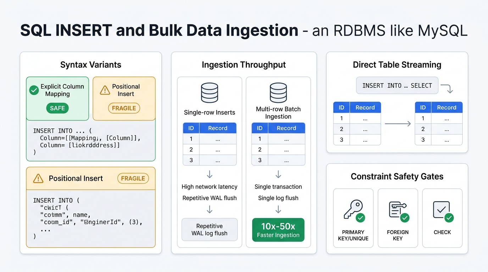

# 🗄️ 30-Day SQL Mastery Roadmap — Day-Wise Learning & Practice Plan

A structured, industry-aligned 30-day curriculum engineered for developers, data analysts, engineers, and students to master Relational Database Management Systems (RDBMS), SQL query craftsmanship, database administration, and query optimization using **MySQL Server & MySQL Workbench** (Port 3306).

---

## ⏱️ Daily Study Routine

| Step | Time | What to Do |
| :--- | :---: | :--- |
| **1. Learn the concepts** | **15–25 min** | Read notes, study syntax patterns, or review the lesson for the day's topic. |
| **2. Write SQL yourself** | **25–40 min** | Type queries directly in MySQL Workbench or the MySQL Shell; avoid copying without understanding. |
| **3. Solve practice questions** | **10–20 min** | Complete exercises, edge-case challenges, or interview-style problems. |
| **4. Review and document** | **5–10 min** | Record errors, syntax corrections, and at least one core architectural takeaway. |

---

## 📅 Day-Wise Master Roadmap

| Day | Status | Topic | Points to Cover | Practice / Task | Expected Output |
| :---: | :---: | :--- | :--- | :--- | :--- |
| **1** | <span style="color:#059669; font-weight:600;">Covered — verify</span> | **DBMS, RDBMS, schema and SQL setup** | DBMS vs RDBMS; tables, rows, columns, schema; SQL command groups; MySQL Server and Workbench connection; port 3306 | Run connection verification queries and identify your practice schema | Working MySQL connection and brief notes |
| **2** | <span style="color:#059669; font-weight:600;">Covered — verify</span> | **SQL syntax and command categories** | Keywords, semicolons, comments, casing; DDL, DML, DQL, DCL, TCL | Classify sample SQL statements by command family | Command-category notes or quiz |
| **3** | <span style="color:#059669; font-weight:600;">Covered — verify</span> | **Database/table creation and data types** | `CREATE DATABASE`, `CREATE TABLE`; `INT`, `VARCHAR`, `DATE`, `BOOLEAN`/MySQL equivalent, `DECIMAL`; `DEFAULT`, `AUTO_INCREMENT` | Create a practice database and core tables | `schema.sql` with initial tables |
| **4** | <span style="color:#059669; font-weight:600;">Covered — verify</span> | **Filtering and NULL handling** | `LIKE`, `%`, `_`, `IN`, `BETWEEN`, `IS NULL`, `IS NOT NULL`; NULL vs zero vs empty string; three-valued logic | Run filtering exercises and review edge cases involving NULL | Filtering practice queries |
| **5** | <span style="color:#2563EB; font-weight:600;">Next</span> | **INSERT and bulk data ingestion** | `INSERT`; insert all columns vs selected columns; multi-row inserts; `INSERT INTO ... SELECT` | Insert sample customers, products, orders, and order items | `seed.sql` with sample data |
| **6** | <span style="color:#2563EB; font-weight:600;">Next</span> | **UPDATE, DELETE, and TRUNCATE safety** | `UPDATE`; multi-column updates; `DELETE`; `TRUNCATE`; `WHERE` safety; transaction/backup awareness | Test targeted updates and deletes only on disposable sample data | Safe DML script and notes on `DELETE` vs `TRUNCATE` |
| **7** | <span style="color:#2563EB; font-weight:600;">Next</span> | **SELECT expressions, aliases, and DISTINCT** | `SELECT`; column projection vs `SELECT *`; aliases with `AS`; calculated expressions; `DISTINCT` | Write queries that calculate totals or apply a sample percentage increase | 10 `SELECT` queries |
| **8** | <span style="color:#2563EB; font-weight:600;">Next</span> | **WHERE, logical operators, and sorting review** | Comparison operators; `AND`, `OR`, `NOT`; parentheses and precedence; `ORDER BY ASC/DESC`; sorting on multiple columns | Answer 10 business questions with filters and sorting | Filtered and sorted query set |
| **9** | <span style="color:#2563EB; font-weight:600;">Next</span> | **LIMIT, OFFSET, and pagination** | `LIMIT`; `OFFSET`; page size and page number; stable sorting for pagination | Build first-page, next-page, and later-page queries for an API-style result list | Three pagination queries |
| **10** | <span style="color:#2563EB; font-weight:600;">Next</span> | **Aggregate functions** | `COUNT(*)`; `COUNT(column)`; `COUNT(DISTINCT column)`; `SUM`; `AVG`; `MIN`; `MAX`; NULL behavior | Calculate order counts, total revenue, average price, and min/max values | At least 8 aggregate queries |
| **11** | <span style="color:#2563EB; font-weight:600;">Next</span> | **GROUP BY and HAVING** | Group by one/multiple columns; aggregate filtering with `HAVING`; `WHERE` vs `HAVING`; logical query-processing order | Calculate sales per customer, order counts by status, and revenue by product | Five grouped reports |
| **12** | <span style="color:#2563EB; font-weight:600;">Next</span> | **Keys, constraints, and relational integrity** | Primary, foreign, unique, candidate, and composite keys; `NOT NULL`; `CHECK` support; referential integrity | Add and test constraints on the practice schema | Improved schema and constraint tests |
| **13** | <span style="color:#2563EB; font-weight:600;">Next</span> | **Normalization** | 1NF, 2NF, 3NF; repeated groups; partial/transitive dependencies; update, insert, and delete anomalies; decomposition | Review a deliberately messy sales table and split it into related tables | Before/after normalized schema |
| **14** | <span style="color:#2563EB; font-weight:600;">Next</span> | **Week 2 assessment and SQL review** | DDL/DML/DQL; filtering; NULL; aggregates; grouping; keys and normalization | Complete a timed quiz and three schema/query challenges | Score, corrections, and a review note |
| **15** | <span style="color:#2563EB; font-weight:600;">Next</span> | **INNER JOIN and multi-table relationships** | Join keys; explicit `ON`; aliases; ambiguous columns; joins across 2–3 tables | Show orders with customers and order items with product names | Three multi-table queries |
| **16** | <span style="color:#2563EB; font-weight:600;">Next</span> | **LEFT JOIN, RIGHT JOIN, and FULL OUTER JOIN concepts** | Preserving unmatched rows; NULLs from unmatched rows; reversing LEFT/RIGHT logic; MySQL FULL OUTER JOIN simulation using `UNION` patterns | Find customers without orders and compare two lists | Two unmatched-record queries and one simulated full join |
| **17** | <span style="color:#2563EB; font-weight:600;">Next</span> | **SELF JOIN and CROSS JOIN** | Self-referencing relationships; employee-manager reporting; parent-child relationships; Cartesian combinations | Write employee-manager and combination queries | One self join and one cross join |
| **18** | <span style="color:#2563EB; font-weight:600;">Next</span> | **Single-row and multi-row subqueries** | Scalar subqueries; `IN`; `NOT IN`; `ANY`; `ALL`; subqueries in `WHERE`/`HAVING`; derived tables in `FROM` | Find products above average price and customers meeting a sales threshold | Five subquery examples |
| **19** | <span style="color:#2563EB; font-weight:600;">Next</span> | **Correlated subqueries, EXISTS, and NOT EXISTS** | Correlated vs standalone subqueries; `EXISTS`; `NOT EXISTS`; NULL considerations with `NOT IN`; compare query plans where practical | Find customers with orders and customers without orders; compare equivalent approaches | Four queries plus a short comparison |
| **20** | <span style="color:#2563EB; font-weight:600;">Next</span> | **Views and index fundamentals** | `CREATE VIEW`; query and drop views; view limitations; B-tree index concept; single-column, unique, and composite indexes; read/write trade-offs | Create a reporting view and test an index in a practice database | One view, one or more test indexes, notes |
| **21** | <span style="color:#2563EB; font-weight:600;">Next</span> | **Joins and subqueries assessment** | Multi-table joins; outer joins; self joins; subqueries; `EXISTS`; views; interpreting results | Solve e-commerce and HR-style query challenges under a time limit | Quiz score and corrected solutions |
| **22** | <span style="color:#2563EB; font-weight:600;">Next</span> | **CASE and conditional aggregation** | Simple/searched `CASE`; `CASE` in `SELECT` and `ORDER BY`; categorization; `SUM(CASE WHEN ...)` | Classify orders by status and count orders per status with conditional aggregation | Five conditional queries |
| **23** | <span style="color:#2563EB; font-weight:600;">Next</span> | **Window functions: ranking** | `OVER`; `PARTITION BY`; window `ORDER BY`; `ROW_NUMBER`; `RANK`; `DENSE_RANK`; ties vs `GROUP BY` | Rank products by sales within categories | Three ranking queries |
| **24** | <span style="color:#2563EB; font-weight:600;">Next</span> | **Advanced window calculations** | Running totals; moving averages; Top N per group; `LAG`; `LEAD`; ordering and frame basics | Calculate monthly running sales and find each customer's previous order where possible | Three analytical queries |
| **25** | <span style="color:#2563EB; font-weight:600;">Next</span> | **CTEs and recursive queries** | `WITH`; multiple CTEs; readable multi-step queries; recursive CTEs for hierarchies; combining CTEs with joins/window functions | Rewrite a multi-step report with a CTE; try a hierarchy query if supported by your MySQL version | One standard CTE and one recursive CTE example |
| **26** | <span style="color:#2563EB; font-weight:600;">Next</span> | **Transactions, ACID, and permissions** | Atomicity, consistency, isolation, durability; `START TRANSACTION`; `COMMIT`; `ROLLBACK`; `SAVEPOINT`; `GRANT`/`REVOKE`; least privilege | Simulate a safe transfer or order update and test rollback; review user permissions | Transaction demo and permissions notes |
| **27** | <span style="color:#2563EB; font-weight:600;">Next</span> | **Stored procedures and programmable SQL** | `CREATE PROCEDURE`; `CALL`; `IN`, `OUT`, `INOUT`; parameters; conditional logic; error handling basics | Create a procedure that retrieves orders for a customer or summarizes sales | One working stored procedure |
| **28** | <span style="color:#2563EB; font-weight:600;">Next</span> | **Interview drill 1: common SQL problems** | Second/Nth highest salary; duplicates; unmatched rows; departments with no employees; employees with missing managers | Solve Nth-highest salary using `LIMIT`, `DENSE_RANK`, and a subquery where suitable; write duplicate detection and unmatched-row queries | Interview query notebook with explanations |
| **29** | <span style="color:#2563EB; font-weight:600;">Next</span> | **Interview drill 2: analytics and optimization** | Consecutive activity days; customer retention/churn concepts; lifetime value; running balances; `EXPLAIN`; index usage; full table scans; query comparison | Solve two business analytics questions and inspect the plan of one query | Two analytics queries and one optimization note |
| **30** | <span style="color:#D97706; font-weight:600;">Final milestone</span> | **Capstone and grand review** | Combine schema design, DML, filters, aggregates, joins, subqueries, views, indexes, transactions, `CASE`, window functions, CTEs, stored procedures, and query analysis | Build an end-to-end sales/e-commerce database and answer business questions | `schema.sql`, `seed.sql`, `queries.sql`, `procedures.sql`, and `README.md` |

---

## 🏛️ Comprehensive Day-by-Day Syllabus & Guides

### Day 1: DBMS, RDBMS, Schema and SQL Setup
- **Status**: Covered — verify
- **Points to Cover**:
  - DBMS vs RDBMS: Flat file and key storage vs relational integrity governed by Codd's rules.
  - Core structures: tables, rows (records), columns (attributes), and logical schemas.
  - SQL Command Groups: DDL (definition), DML (manipulation), DQL (querying), DCL (control), and TCL (transaction control).
  - Environment setup: MySQL Server local instance, connecting via MySQL Workbench on default port `3306`, verifying service status.
- **Practice / Task**:
  - Run verification queries (`SELECT VERSION();`, `SHOW DATABASES;`, `SELECT CURRENT_USER();`) and select or create your practice schema.
- **Expected Output**:
  - Verified MySQL connection status and brief environment notes.

---

### Day 2: SQL Syntax and Command Categories
- **Status**: Covered — verify
- **Points to Cover**:
  - SQL Lexical conventions: uppercase keywords (`SELECT`), lowercase identifiers (`table_name`), mandatory statement terminator semicolon (`;`).
  - Comment styles: Single line (`-- ` or `# ` in MySQL) and multi-line block comments (`/* ... */`).
  - Categorizing commands:
    - **DDL**: `CREATE`, `ALTER`, `DROP`, `TRUNCATE`, `RENAME`.
    - **DML**: `INSERT`, `UPDATE`, `DELETE`.
    - **DQL**: `SELECT`.
    - **DCL**: `GRANT`, `REVOKE`.
    - **TCL**: `COMMIT`, `ROLLBACK`, `SAVEPOINT`.
- **Practice / Task**:
  - Classify 15 sample SQL statements into their appropriate command family.
- **Expected Output**:
  - Structured command-category reference document.

---

### Day 3: Database/Table Creation and Data Types
- **Status**: Covered — verify
- **Points to Cover**:
  - `CREATE DATABASE IF NOT EXISTS practice_db;` and `USE practice_db;`.
  - Core data types:
    - Integers: `INT`, `BIGINT`, `SMALLINT`, `TINYINT`.
    - Strings: `VARCHAR(n)` (variable length) vs `CHAR(n)` (fixed).
    - Decimals: `DECIMAL(10, 2)` (exact precision for financial math).
    - Temporal: `DATE`, `DATETIME`, `TIMESTAMP`.
    - Boolean: `BOOLEAN` (in MySQL, synonym for `TINYINT(1)` with `1=TRUE`, `0=FALSE`).
  - Column Modifiers: `DEFAULT`, `AUTO_INCREMENT`, `NOT NULL`.
- **Practice / Task**:
  - Author a script creating initial `customers`, `products`, and `orders` tables.
- **Expected Output**:
  - Runnable `schema.sql` file containing clean DDL table definitions.

---

### Day 4: Filtering and NULL Handling
- **Status**: Covered — verify
- **Points to Cover**:
  - Pattern matching: `LIKE '%pattern%'` (`%` represents 0 or more characters, `_` represents exactly 1 character).
  - Set & Range filters: `IN (...)`, `NOT IN (...)`, `BETWEEN low AND high`.
  - The semantics of `NULL`:
    - `NULL` represents missing or unknown information.
    - `NULL != 0` and `NULL != ''`.
    - Three-Valued Logic: `TRUE`, `FALSE`, and `UNKNOWN`.
    - Always use `IS NULL` or `IS NOT NULL` (never `= NULL`).
- **Practice / Task**:
  - Execute filtering queries on customers with missing phone numbers, prices in ranges, and specific email domains.
- **Expected Output**:
  - Verified filtering practice queries handling edge cases with `NULL`.

---

### Day 5: INSERT and Bulk Data Ingestion

<div align="center">
  
  <p><em>Figure 5.1: High-Performance Data Ingestion Architecture — Explicit Column Mapping vs. Positional, Single-Row vs. Multi-Row Batching (10x–50x Throughput), Direct Table Streaming (INSERT INTO ... SELECT), and Engine Constraint Gates.</em></p>
</div>

---

#### 1. Conceptual Deep-Dive (20–25 Minutes)

##### The Role of Data Manipulation Language (DML)
Data Manipulation Language (DML) handles data records within existing schema structures without altering table definitions. Unlike DDL statements which auto-commit and modify the data dictionary catalog, DML commands (`INSERT`, `UPDATE`, `DELETE`, `SELECT`) operate inside transactional boundaries that can be rolled back upon error. The fundamental write command is `INSERT INTO`.

##### Syntax Variants: Positional vs. Explicit Columns
1. **Positional Insert (All Columns)**:
   Requires supplying a value for every single column in the exact positional sequence defined in the physical schema.
   ```sql
   INSERT INTO table_name
   VALUES (val1, val2, val3, ...);
   ```
   > [!WARNING]
   > **Production Fragility Risk**: Adding, dropping, or reordering columns via `ALTER TABLE` will silently break this query or map values into incorrect columns. Positional insertion is strongly discouraged in production codebases.

2. **Explicit Column Insert (Recommended Standard)**:
   Explicitly lists target destination columns before the `VALUES` keyword. Missing columns will automatically take their declared `DEFAULT` value, generate an `AUTO_INCREMENT` sequence, or insert `NULL` (if permitted).
   ```sql
   INSERT INTO table_name (col1, col3)
   VALUES (val1, val3);
   ```
   *Benefit*: Decouples application query logic from physical table schema evolution.

##### Single-Row vs. Multi-Row (Batch) Ingestion
Every `INSERT` statement sent to a relational engine incurs network round-trip latency, transaction boundary locking, and Write-Ahead Log (WAL / redo log) disk flushing.

- **Single-Row Inserts (Anti-Pattern for Volume)**:
  Executing 1,000 separate `INSERT INTO ... VALUES (...)` statements creates 1,000 distinct transactions by default (under `autocommit = 1`), severely choking disk I/O and network bandwidth.
- **Batch / Multi-Row Ingestion (High-Throughput)**:
  Combines multiple record tuples within a single statement, separated by commas:
  ```sql
  INSERT INTO table_name (col1, col2)
  VALUES
    (val1_a, val2_a),
    (val1_b, val2_b),
    (val1_c, val2_c);
  ```
  *Engine Impact*: Generates one parser pass, one atomic transaction, and a single Write-Ahead Log flush, delivering **10x–50x faster ingestion throughput**.

##### Inserting from Existing Tables: `INSERT INTO ... SELECT`
Enables moving or transforming data directly within the database engine without exporting bytes over the network to an application layer. Column data types and count in the `SELECT` clause must map directly to the target table's columns:
```sql
INSERT INTO target_table (col1, col2)
SELECT source_col1, source_col2
FROM source_table
WHERE condition;
```

##### Handling Default Values and AUTO_INCREMENT
- **`AUTO_INCREMENT`**: Omit the column name from the insert list, or supply `NULL` or `DEFAULT`. The database engine assigns the next integer sequence automatically.
- **`DEFAULT`**: Omitting a column with a configured default inserts that default automatically. You can also explicitly specify the `DEFAULT` keyword in the values list:
  ```sql
  INSERT INTO customers (first_name, last_name, email, status)
  VALUES ('Alex', 'Smith', 'alex@example.com', DEFAULT);
  ```

---

#### 2. Hands-on Lab: `schema.sql` Setup
Run this script in MySQL Workbench or the MySQL Command Line Client to establish a clean, production-grade sandbox environment for your sales/e-commerce capstone tables:

```sql
-- 1. Create a clean sandbox database
CREATE DATABASE IF NOT EXISTS ecommerce_lab;
USE ecommerce_lab;

-- 2. Drop existing tables in reverse dependency order
DROP TABLE IF EXISTS order_items;
DROP TABLE IF EXISTS orders;
DROP TABLE IF EXISTS products;
DROP TABLE IF EXISTS customers;

-- 3. Create tables with keys, defaults, and constraints
CREATE TABLE customers (
    customer_id INT AUTO_INCREMENT PRIMARY KEY,
    first_name  VARCHAR(50) NOT NULL,
    last_name   VARCHAR(50) NOT NULL,
    email       VARCHAR(100) NOT NULL UNIQUE,
    created_at  DATETIME DEFAULT CURRENT_TIMESTAMP,
    status      VARCHAR(20) DEFAULT 'ACTIVE'
);

CREATE TABLE products (
    product_id   INT AUTO_INCREMENT PRIMARY KEY,
    product_name VARCHAR(100) NOT NULL,
    category     VARCHAR(50) NOT NULL,
    price        DECIMAL(10, 2) NOT NULL CHECK (price >= 0),
    stock_qty    INT NOT NULL DEFAULT 0 CHECK (stock_qty >= 0)
);

CREATE TABLE orders (
    order_id    INT AUTO_INCREMENT PRIMARY KEY,
    customer_id INT NOT NULL,
    order_date  DATETIME DEFAULT CURRENT_TIMESTAMP,
    status      VARCHAR(30) DEFAULT 'PENDING',
    CONSTRAINT fk_orders_customer
        FOREIGN KEY (customer_id) REFERENCES customers(customer_id)
        ON DELETE RESTRICT
);

CREATE TABLE order_items (
    order_item_id INT AUTO_INCREMENT PRIMARY KEY,
    order_id      INT NOT NULL,
    product_id    INT NOT NULL,
    quantity      INT NOT NULL CHECK (quantity > 0),
    unit_price    DECIMAL(10, 2) NOT NULL CHECK (unit_price >= 0),
    CONSTRAINT fk_items_order
        FOREIGN KEY (order_id) REFERENCES orders(order_id)
        ON DELETE CASCADE,
    CONSTRAINT fk_items_product
        FOREIGN KEY (product_id) REFERENCES products(product_id)
        ON DELETE RESTRICT
);
```

---

#### 3. Practical Work: `seed.sql`
Save and execute the following script to test the 6 fundamental data ingestion patterns across relational boundaries:

```sql
USE ecommerce_lab;

-- Pattern 1: Single-row insert using explicit columns
INSERT INTO customers (first_name, last_name, email)
VALUES ('Aarav', 'Sharma', 'aarav.sharma@example.com');

-- Pattern 2: Multi-row (batch) insert
INSERT INTO customers (first_name, last_name, email, status)
VALUES
    ('Diya', 'Patel', 'diya.patel@example.com', 'ACTIVE'),
    ('Rohan', 'Verma', 'rohan.verma@example.com', 'ACTIVE'),
    ('Ananya', 'Iyer', 'ananya.iyer@example.com', 'INACTIVE'),
    ('Kabir', 'Mehta', 'kabir.mehta@example.com', 'ACTIVE');

-- Pattern 3: Batch insert into products
INSERT INTO products (product_name, category, price, stock_qty)
VALUES
    ('Mechanical Keyboard', 'Electronics', 119.99, 45),
    ('Wireless Mouse', 'Electronics', 49.50, 120),
    ('Ergonomic Chair', 'Furniture', 289.00, 15),
    ('Standing Desk', 'Furniture', 450.00, 8),
    ('USB-C Hub', 'Electronics', 35.75, 80),
    ('Ceramic Coffee Mug', 'Kitchenware', 14.00, 200);

-- Pattern 4: Relational multi-row inserts into orders
-- Referencing valid customer IDs (1, 2, 3)
INSERT INTO orders (customer_id, status, order_date)
VALUES
    (1, 'COMPLETED', '2026-10-15 10:30:00'),
    (2, 'PROCESSING', '2026-10-18 14:15:00'),
    (1, 'COMPLETED', '2026-10-20 09:00:00'),
    (3, 'CANCELLED', '2026-10-22 18:45:00');

-- Pattern 5: Inserting order line items with explicit pricing
INSERT INTO order_items (order_id, product_id, quantity, unit_price)
VALUES
    (1, 1, 1, 119.99),
    (1, 2, 1, 49.50),
    (2, 3, 1, 289.00),
    (3, 5, 2, 35.75),
    (4, 6, 4, 14.00);

-- Pattern 6: Bulk Ingestion via INSERT INTO ... SELECT
-- Create an archival/staging table for inactive customers
CREATE TABLE IF NOT EXISTS archived_customers (
    archive_id  INT AUTO_INCREMENT PRIMARY KEY,
    original_id INT,
    full_name   VARCHAR(105),
    email       VARCHAR(100),
    archived_at DATETIME DEFAULT CURRENT_TIMESTAMP
);

-- Ingest into archive directly from customers table using SELECT
INSERT INTO archived_customers (original_id, full_name, email)
SELECT 
    customer_id, 
    CONCAT(first_name, ' ', last_name), 
    email
FROM customers
WHERE status = 'INACTIVE';

-- Verification Query
SELECT * FROM archived_customers;
```

---

#### 4. Edge Cases & Constraint Traps

| Constraint Violation | Trigger Scenario | MySQL Error Code & Message | Remediation |
| :--- | :--- | :--- | :--- |
| **Duplicate Key (`UNIQUE` / `PK`)** | Inserting `'aarav.sharma@example.com'` a second time | `Error Code: 1062. Duplicate entry 'aarav.sharma@example.com' for key 'customers.email'` | Ensure natural business keys are unique or use `INSERT IGNORE` / `ON DUPLICATE KEY UPDATE`. |
| **Orphaned Foreign Key (`FK`)** | Inserting an order with non-existent `customer_id = 999` | `Error Code: 1452. Cannot add or update a child row: a foreign key constraint fails` | Insert parent entity (`customers`) before creating child records (`orders`). |
| **Check Violation (`CHECK`)** | Inserting negative price: `('Defective Desk', 'Furniture', -25.00, 10)` | `Error Code: 3819. Check constraint 'products_chk_1' is violated.` | Validate domain business logic at the application layer before executing write queries. |

---

#### 5. Day 5 Practice Exercises

- [ ] **Exercise 1 (Column Variations)**: Write an `INSERT` statement for the `products` table that only provides `product_name`, `category`, and `price`. Verify whether `stock_qty` receives its declared default value of `0` and `product_id` generates the next auto-increment sequence.
- [ ] **Exercise 2 (Batch Transactional Integrity)**: Write a single multi-row `INSERT` statement for `customers` containing 3 rows where the 2nd row contains an already-existing email (`'diya.patel@example.com'`). Observe whether rows 1 and 3 are inserted, or if the entire batch aborts atomically.
  - *Key Takeaway*: In MySQL InnoDB, a single multi-row statement is atomic; any single constraint failure causes the entire statement to fail with zero rows inserted.
- [ ] **Exercise 3 (Conditional `INSERT ... SELECT`)**: Create a backup table `high_value_products (product_id INT, product_name VARCHAR(100), price DECIMAL(10,2))`. Populate it using `INSERT INTO ... SELECT` for all products with a price greater than `100.00`.
- [ ] **Exercise 4 (Identity Generation)**: Execute `SELECT LAST_INSERT_ID();` immediately after inserting a new customer record to see how MySQL reports the last generated sequence ID for that connection session.

---

#### 6. 50 Practice Problems Catalog (Parts 1–8)

##### Part 1: Single-Row Inserts with Explicit Columns (Problems 1–8)
1. **Problem 1**: Register a new customer named Priya Nair (`priya.nair@example.com`).
   ```sql
   INSERT INTO customers (first_name, last_name, email)
   VALUES ('Priya', 'Nair', 'priya.nair@example.com');
   ```
2. **Problem 2**: Add a product called "Desk Lamp" to "Electronics" ($24.99, stock 50).
   ```sql
   INSERT INTO products (product_name, category, price, stock_qty)
   VALUES ('Desk Lamp', 'Electronics', 24.99, 50);
   ```
3. **Problem 3**: Create an order for customer 1 with status 'PENDING'.
   ```sql
   INSERT INTO orders (customer_id, status)
   VALUES (1, 'PENDING');
   ```
4. **Problem 4**: Add line-item to order 1 for product 1 (qty 2 at $24.99).
   ```sql
   INSERT INTO order_items (order_id, product_id, quantity, unit_price)
   VALUES (1, 1, 2, 24.99);
   ```
5. **Problem 5**: Insert customer Rahul Dravid (`rahul.d@example.com`) with status 'ACTIVE'.
   ```sql
   INSERT INTO customers (first_name, last_name, email, status)
   VALUES ('Rahul', 'Dravid', 'rahul.d@example.com', 'ACTIVE');
   ```
6. **Problem 6**: Add "Monitor Stand" under "Furniture" ($39.50, stock 25).
   ```sql
   INSERT INTO products (product_name, category, price, stock_qty)
   VALUES ('Monitor Stand', 'Furniture', 39.50, 25);
   ```
7. **Problem 7**: Backdated order for customer 2 on Oct 1, 2026 at 11:20:00 AM ('COMPLETED').
   ```sql
   INSERT INTO orders (customer_id, status, order_date)
   VALUES (2, 'COMPLETED', '2026-10-01 11:20:00');
   ```
8. **Problem 8**: Discounted line item for order 2, product 2 (qty 1 at $35.00).
   ```sql
   INSERT INTO order_items (order_id, product_id, quantity, unit_price)
   VALUES (2, 2, 1, 35.00);
   ```

##### Part 2: Column Order Variations & Permutations (Problems 9–14)
9. **Problem 9**: Insert customer with column order: `email`, `last_name`, `first_name`.
   ```sql
   INSERT INTO customers (email, last_name, first_name)
   VALUES ('vikram.s@example.com', 'Seth', 'Vikram');
   ```
10. **Problem 10**: Insert product with column order: `price`, `stock_qty`, `category`, `product_name`.
    ```sql
    INSERT INTO products (price, stock_qty, category, product_name)
    VALUES (19.99, 100, 'Stationery', 'Gel Pens (Pack of 10)');
    ```
11. **Problem 11**: Create order for customer 3 listing `status` before `customer_id`.
    ```sql
    INSERT INTO orders (status, customer_id)
    VALUES ('PROCESSING', 3);
    ```
12. **Problem 12**: Reverse order items column order: `unit_price`, `quantity`, `product_id`, `order_id`.
    ```sql
    INSERT INTO order_items (unit_price, quantity, product_id, order_id)
    VALUES (19.99, 3, 3, 3);
    ```
13. **Problem 13**: Insert customer with columns: `status`, `email`, `first_name`, `last_name`.
    ```sql
    INSERT INTO customers (status, email, first_name, last_name)
    VALUES ('SUSPENDED', 'suresh.k@example.com', 'Suresh', 'K');
    ```
14. **Problem 14**: Insert "Ultra-Wide Monitor" with `stock_qty` first and `category` last.
    ```sql
    INSERT INTO products (stock_qty, price, product_name, category)
    VALUES (12, 599.00, 'Ultra-Wide Monitor', 'Electronics');
    ```

##### Part 3: Handling Defaults, Expressions & System Functions (Problems 15–20)
15. **Problem 15**: Insert customer Meera Sen using explicit `DEFAULT` keyword for status.
    ```sql
    INSERT INTO customers (first_name, last_name, email, status)
    VALUES ('Meera', 'Sen', 'meera.sen@example.com', DEFAULT);
    ```
16. **Problem 16**: Insert "Noise-Cancelling Headphones" omitting `stock_qty` to test default 0.
    ```sql
    INSERT INTO products (product_name, category, price)
    VALUES ('Noise-Cancelling Headphones', 'Electronics', 149.99);
    ```
17. **Problem 17**: Generate email dynamically via `LOWER(CONCAT(...))`.
    ```sql
    INSERT INTO customers (first_name, last_name, email)
    VALUES ('Amit', 'Kumar', LOWER(CONCAT('Amit', '.', 'Kumar', '@example.com')));
    ```
18. **Problem 18**: Insert order explicitly setting `order_date` to `NOW()`.
    ```sql
    INSERT INTO orders (customer_id, status, order_date)
    VALUES (1, 'SHIPPED', NOW());
    ```
19. **Problem 19**: Calculate 10% discount inline: `ROUND(599.00 * 0.90, 2)`.
    ```sql
    INSERT INTO order_items (order_id, product_id, quantity, unit_price)
    VALUES (4, 4, 1, ROUND(599.00 * 0.90, 2));
    ```
20. **Problem 20**: Set price as `49.50 + 15.00` and stock quantity as `5 * 8`.
    ```sql
    INSERT INTO products (product_name, category, price, stock_qty)
    VALUES ('Accessory Bundle', 'Electronics', 49.50 + 15.00, 5 * 8);
    ```

##### Part 4: Multi-Row Batch Ingestion (Problems 21–28)
21. **Problem 21**: Insert Arjun, Pooja, and Karan in a single batch statement.
    ```sql
    INSERT INTO customers (first_name, last_name, email, status)
    VALUES
        ('Arjun', 'Kapoor', 'arjun.k@example.com', 'ACTIVE'),
        ('Pooja', 'Hegde', 'pooja.h@example.com', 'ACTIVE'),
        ('Karan', 'Johar', 'karan.j@example.com', 'INACTIVE');
    ```
22. **Problem 22**: Bulk insert three stationery supplies in one query.
    ```sql
    INSERT INTO products (product_name, category, price, stock_qty)
    VALUES
        ('Notebook Spiral', 'Stationery', 4.50, 300),
        ('Correction Tape', 'Stationery', 2.25, 150),
        ('Stapler Heavy Duty', 'Stationery', 12.00, 80);
    ```
23. **Problem 23**: Ingest 4 orders across customers 1, 2, 3, and 5 in one statement.
    ```sql
    INSERT INTO orders (customer_id, status, order_date)
    VALUES
        (1, 'COMPLETED', '2026-10-10 09:00:00'),
        (2, 'COMPLETED', '2026-10-11 10:15:00'),
        (3, 'PENDING',   '2026-10-12 14:30:00'),
        (5, 'CANCELLED', '2026-10-13 18:00:00');
    ```
24. **Problem 24**: Add 3 line items for order 5 in a single batch query.
    ```sql
    INSERT INTO order_items (order_id, product_id, quantity, unit_price)
    VALUES
        (5, 1, 1, 24.99),
        (5, 2, 2, 39.50),
        (5, 7, 4, 4.50);
    ```
25. **Problem 25**: Add line items across orders 6, 7, and 8 in a single query.
    ```sql
    INSERT INTO order_items (order_id, product_id, quantity, unit_price)
    VALUES
        (6, 4, 1, 599.00),
        (7, 6, 1, 149.99),
        (8, 8, 3, 2.25);
    ```
26. **Problem 26**: Ingest four hardware accessories into "Electronics".
    ```sql
    INSERT INTO products (product_name, category, price, stock_qty)
    VALUES
        ('Bluetooth Adapter', 'Electronics', 15.99, 120),
        ('HDMI 2.1 Cable', 'Electronics', 18.50, 200),
        ('Webcam 1080p', 'Electronics', 55.00, 40),
        ('Condenser Mic', 'Electronics', 75.00, 30);
    ```
27. **Problem 27**: Insert three customers with varying account states in one query.
    ```sql
    INSERT INTO customers (first_name, last_name, email, status)
    VALUES
        ('Siddharth', 'Roy', 'sid.roy@example.com', 'ACTIVE'),
        ('Tara', 'Sutaria', 'tara.s@example.com', 'PENDING_VERIFICATION'),
        ('Varun', 'Dhawan', 'varun.d@example.com', 'ACTIVE');
    ```
28. **Problem 28**: Record two line items for order 6 at volume discounts.
    ```sql
    INSERT INTO order_items (order_id, product_id, quantity, unit_price)
    VALUES
        (6, 4, 2, 550.00),
        (6, 10, 5, 15.00);
    ```

##### Part 5: Full-Tuple Positional Inserts (Problems 29–33)
29. **Problem 29**: Insert customer positionally setting `customer_id` explicitly to 50.
    ```sql
    INSERT INTO customers
    VALUES (50, 'Gaurav', 'Kapoor', 'gaurav.k@example.com', '2026-10-01 00:00:00', 'ACTIVE');
    ```
30. **Problem 30**: Insert customer positionally using `NULL` for auto-increment.
    ```sql
    INSERT INTO customers
    VALUES (NULL, 'Rhea', 'Pillai', 'rhea.p@example.com', NOW(), 'ACTIVE');
    ```
31. **Problem 31**: Positionally insert product with `DEFAULT` for ID and stock.
    ```sql
    INSERT INTO products
    VALUES (DEFAULT, 'Footrest Ergonomic', 'Furniture', 29.99, DEFAULT);
    ```
32. **Problem 32**: Insert order positionally for customer 50 with `DEFAULT` for order_id.
    ```sql
    INSERT INTO orders
    VALUES (DEFAULT, 50, '2026-10-25 15:45:00', 'PENDING');
    ```
33. **Problem 33**: Insert two order items positionally in one query with `NULL` PK.
    ```sql
    INSERT INTO order_items
    VALUES 
        (NULL, 9, 1, 1, 24.99),
        (NULL, 9, 2, 2, 39.50);
    ```

##### Part 6: Selective Ingestion (INSERT INTO ... SELECT) (Problems 34–42)
34. **Problem 34**: Copy products with price > $50.00 into `product_catalog_backup`.
    ```sql
    INSERT INTO product_catalog_backup (product_id, product_name, price)
    SELECT product_id, product_name, price
    FROM products
    WHERE price > 50.00;
    ```
35. **Problem 35**: Back up all products in the "Furniture" category.
    ```sql
    INSERT INTO product_catalog_backup (product_id, product_name, price)
    SELECT product_id, product_name, price
    FROM products
    WHERE category = 'Furniture';
    ```
36. **Problem 36**: Populate `marketing_leads` from 'ACTIVE' customers with full name.
    ```sql
    INSERT INTO marketing_leads (lead_email, lead_name, source_status)
    SELECT email, CONCAT(first_name, ' ', last_name), status
    FROM customers
    WHERE status = 'ACTIVE';
    ```
37. **Problem 37**: Populate `marketing_leads` with 'PENDING_VERIFICATION' customers.
    ```sql
    INSERT INTO marketing_leads (lead_email, lead_name, source_status)
    SELECT email, CONCAT(first_name, ' ', last_name), status
    FROM customers
    WHERE status = 'PENDING_VERIFICATION';
    ```
38. **Problem 38**: Identify out-of-stock products (`stock_qty = 0`) and alert.
    ```sql
    INSERT INTO out_of_stock_alerts (product_id, product_name, detected_at)
    SELECT product_id, product_name, NOW()
    FROM products
    WHERE stock_qty = 0;
    ```
39. **Problem 39**: Compute revenue snapshots for orders 1 through 5.
    ```sql
    INSERT INTO order_financial_snapshots (order_id, total_revenue)
    SELECT order_id, SUM(quantity * unit_price)
    FROM order_items
    WHERE order_id <= 5
    GROUP BY order_id;
    ```
40. **Problem 40**: Compute revenue snapshots for orders greater than 5.
    ```sql
    INSERT INTO order_financial_snapshots (order_id, total_revenue)
    SELECT order_id, SUM(quantity * unit_price)
    FROM order_items
    WHERE order_id > 5
    GROUP BY order_id;
    ```
41. **Problem 41**: Backup Stationery products with a 10% price markup during insertion.
    ```sql
    INSERT INTO product_catalog_backup (product_id, product_name, price)
    SELECT product_id, product_name, ROUND(price * 1.10, 2)
    FROM products
    WHERE category = 'Stationery';
    ```
42. **Problem 42**: Create and populate `temp_customer_emails` with lowercased emails.
    ```sql
    CREATE TEMPORARY TABLE temp_customer_emails (
        cid INT,
        clean_email VARCHAR(100)
    );

    INSERT INTO temp_customer_emails (cid, clean_email)
    SELECT customer_id, LOWER(email)
    FROM customers;
    ```

##### Part 7: Upserts & Conflict Handling (ON DUPLICATE KEY UPDATE / IGNORE) (Problems 43–47)
43. **Problem 43**: Insert customer with `INSERT IGNORE` to silence duplicate key errors.
    ```sql
    INSERT IGNORE INTO customers (first_name, last_name, email)
    VALUES ('Priya', 'Nair', 'priya.nair@example.com');
    ```
44. **Problem 44**: Upsert customer: if email exists, update status to 'VERIFIED'.
    ```sql
    INSERT INTO customers (first_name, last_name, email, status)
    VALUES ('Rahul', 'Dravid', 'rahul.d@example.com', 'ACTIVE')
    ON DUPLICATE KEY UPDATE 
        status = 'VERIFIED';
    ```
45. **Problem 45**: Upsert product: if present, increment stock quantity by 15.
    ```sql
    INSERT INTO products (product_id, product_name, category, price, stock_qty)
    VALUES (1, 'Desk Lamp', 'Electronics', 24.99, 15)
    ON DUPLICATE KEY UPDATE 
        stock_qty = stock_qty + VALUES(stock_qty);
    ```
46. **Problem 46**: Upsert order snapshot: replace `total_revenue` with recalculated value.
    ```sql
    INSERT INTO order_financial_snapshots (order_id, total_revenue)
    VALUES (1, 99.98)
    ON DUPLICATE KEY UPDATE 
        total_revenue = VALUES(total_revenue);
    ```
47. **Problem 47**: Batch insert marketing leads with `INSERT IGNORE` to skip duplicates.
    ```sql
    INSERT IGNORE INTO marketing_leads (lead_email, lead_name, source_status)
    VALUES 
        ('priya.nair@example.com', 'Priya Nair', 'ACTIVE'),
        ('new.lead@example.com', 'New Lead', 'PROSPECT');
    ```

##### Part 8: Advanced Ingestion Edge Cases (Problems 48–50)
48. **Problem 48**: Insert customer and retrieve identity key using `LAST_INSERT_ID()`.
    ```sql
    INSERT INTO customers (first_name, last_name, email)
    VALUES ('Kavita', 'Krishnan', 'kavita.k@example.com');

    SELECT LAST_INSERT_ID() AS newly_generated_customer_id;
    ```
49. **Problem 49**: Chain child order insertion directly using `LAST_INSERT_ID()`.
    ```sql
    INSERT INTO orders (customer_id, status)
    VALUES (LAST_INSERT_ID(), 'PENDING');
    ```
50. **Problem 50**: Ingest snapshots using inline `CASE` enforcing a minimum floor of $10.00.
    ```sql
    INSERT INTO order_financial_snapshots (order_id, total_revenue)
    SELECT 
        order_id, 
        CASE 
            WHEN SUM(quantity * unit_price) < 10.00 THEN 10.00 
            ELSE SUM(quantity * unit_price) 
        END AS final_revenue
    FROM order_items
    WHERE order_id NOT IN (SELECT order_id FROM order_financial_snapshots)
    GROUP BY order_id;
    ```

---

### Day 6: UPDATE, DELETE, and TRUNCATE Safety
- **Status**: Next
- **Points to Cover**:
  - `UPDATE table_name SET col1 = val1, col2 = val2 WHERE condition;`.
  - Multi-column updates.
  - `DELETE FROM table_name WHERE condition;`.
  - `TRUNCATE TABLE table_name;`: Fast, non-logged or reset auto-increment behavior vs row-by-row `DELETE`.
  - Safe update mode (`SQL_SAFE_UPDATES = 1`) in MySQL Workbench.
  - Production safety rules: Always run a `SELECT` with the exact `WHERE` clause first.
- **Practice / Task**:
  - Safely update product prices and delete canceled test orders on disposable data.
- **Expected Output**:
  - Safe DML script and architectural notes comparing `DELETE` vs `TRUNCATE`.

---

### Day 7: SELECT Expressions, Aliases, and DISTINCT
- **Status**: Next
- **Points to Cover**:
  - Explicit projection vs wildcard (`SELECT *`) performance impact.
  - Column aliasing using `AS` for clear business labels.
  - Mathematical calculated expressions: discounts, sales tax calculations, line item totals (`quantity * unit_price`).
  - `DISTINCT` for deduplication across one or more projected columns.
- **Practice / Task**:
  - Write queries projecting computed metrics and unique customer cities.
- **Expected Output**:
  - 10 distinct `SELECT` projection queries.

---

### Day 8: WHERE, Logical Operators, and Sorting Review
- **Status**: Next
- **Points to Cover**:
  - Relational comparison operators: `=`, `<>`, `!=`, `<`, `>`, `<=`, `>=`.
  - Boolean combinations: `AND`, `OR`, `NOT`.
  - Operator precedence rules and the critical importance of parentheses `(A OR B) AND C`.
  - `ORDER BY` mechanics: `ASC` (default), `DESC`, sorting by column alias or positional index.
  - Multi-column sorting (e.g., sort by `status ASC`, then `order_date DESC`).
- **Practice / Task**:
  - Solve 10 specific business scenarios requiring multi-condition filtering and sorted reports.
- **Expected Output**:
  - Filtered and sorted business query set.

---

### Day 9: LIMIT, OFFSET, and Pagination
- **Status**: Next
- **Points to Cover**:
  - Syntax: `LIMIT count OFFSET offset;` or MySQL shorthand `LIMIT offset, count;`.
  - Calculating pagination offsets: $\text{Offset} = (\text{Page Number} - 1) \times \text{Page Size}$.
  - The necessity of deterministic, stable sorting (`ORDER BY id`) to avoid duplicate or skipped rows between pages.
- **Practice / Task**:
  - Build paginated API queries for Page 1, Page 2, and Page 3 of an order history list.
- **Expected Output**:
  - 3 pagination query scripts simulating backend REST API endpoints.

---

### Day 10: Aggregate Functions
- **Status**: Next
- **Points to Cover**:
  - The 5 Standard Aggregates:
    - `COUNT(*)` (counts all rows including NULLs).
    - `COUNT(column)` (counts non-null values only).
    - `COUNT(DISTINCT column)` (counts unique non-null values).
    - `SUM(column)` (computes total sum; ignores NULL).
    - `AVG(column)` (arithmetic mean; ignores NULL).
    - `MIN(column)` and `MAX(column)` (smallest and largest values across numbers, dates, or strings).
- **Practice / Task**:
  - Calculate total store revenue, average customer order value, and product price spreads.
- **Expected Output**:
  - At least 8 aggregate reporting queries with documented output tables.

---

### Day 11: GROUP BY and HAVING
- **Status**: Next
- **Points to Cover**:
  - Grouping rows by dimension columns.
  - The logical query processing hierarchy:
    1. `FROM`
    2. `WHERE` (filters rows before aggregation)
    3. `GROUP BY` (collapses rows into buckets)
    4. `HAVING` (filters aggregate summary buckets)
    5. `SELECT` (evaluates projection expressions)
    6. `ORDER BY` (sorts final result set)
    7. `LIMIT` (restricts row count)
  - Crucial rule: Never use aggregate functions in the `WHERE` clause.
- **Practice / Task**:
  - Calculate order count per customer status and filter for product categories with revenue exceeding $5,000 using `HAVING`.
- **Expected Output**:
  - 5 grouped business intelligence reports.

---

### Day 12: Keys, Constraints, and Relational Integrity
- **Status**: Next
- **Points to Cover**:
  - Key classifications: Primary Key, Foreign Key, Unique Key, Candidate Key, and Composite Key.
  - Integrity Constraints: `PRIMARY KEY`, `FOREIGN KEY ... REFERENCES`, `NOT NULL`, `UNIQUE`, `CHECK`.
  - Referential action cascades: `ON DELETE CASCADE`, `ON DELETE SET NULL`, `ON DELETE RESTRICT`.
- **Practice / Task**:
  - Add foreign key relationships and check constraints to `schema.sql`; test constraint violations with invalid inserts.
- **Expected Output**:
  - Hardened schema script and verification log of constraint error handling.

---

### Day 13: Normalization (1NF, 2NF, 3NF)
- **Status**: Next
- **Points to Cover**:
  - Database Anomalies: Update anomaly, Insertion anomaly, Deletion anomaly.
  - **First Normal Form (1NF)**: Atomic values per cell, unique column names, primary key defined, no repeating groups.
  - **Second Normal Form (2NF)**: In 1NF and no partial functional dependency (every non-key attribute is fully dependent on the entire primary key).
  - **Third Normal Form (3NF)**: In 2NF and no transitive dependency (non-key attributes depend only on the primary key, not on other non-key attributes).
- **Practice / Task**:
  - Take a denormalized single-table spreadsheet (customer, address, order, product, price in one row) and decompose it into 3NF.
- **Expected Output**:
  - Before/after normalization schema diagram and decomposition documentation.

---

### Day 14: Week 2 Assessment and SQL Review
- **Status**: Next
- **Points to Cover**:
  - Comprehensive review of DDL, DML, DQL, filtering, NULL logic, aggregate functions, `GROUP BY`, `HAVING`, keys, and normalization.
  - Timed self-assessment covering 15 concept questions and 3 schema/query challenges.
- **Practice / Task**:
  - Solve timed query problems without looking up answers.
- **Expected Output**:
  - Self-assessment score, error analysis, and Week 2 review synthesis notes.

---

### Day 15: INNER JOIN and Multi-Table Relationships
- **Status**: Next
- **Points to Cover**:
  - Relational join mechanics matching keys between tables.
  - Explicit join syntax: `FROM tableA a INNER JOIN tableB b ON a.id = b.a_id`.
  - Table aliasing for readability and disambiguating columns.
  - Chaining multi-table joins: `customers` ➔ `orders` ➔ `order_items` ➔ `products`.
- **Practice / Task**:
  - Write queries displaying full itemized invoices showing customer name, order date, product title, quantity, and subtotal.
- **Expected Output**:
  - 3 multi-table `INNER JOIN` queries.

---

### Day 16: LEFT JOIN, RIGHT JOIN, and FULL OUTER JOIN Concepts
- **Status**: Next
- **Points to Cover**:
  - Outer join principles: Preserving rows from one table regardless of whether matches exist in the joined table.
  - `LEFT JOIN`: Keeps all left table rows, fills right table columns with `NULL` when unmatched.
  - `RIGHT JOIN`: Keeps all right table rows (best practice: prefer `LEFT JOIN` for consistency).
  - Finding missing relationships (Anti-Joins): `WHERE right_table.id IS NULL`.
  - MySQL `FULL OUTER JOIN` simulation: Using `LEFT JOIN` `UNION` `RIGHT JOIN`.
- **Practice / Task**:
  - Find customers who have never placed an order, and products that have never been purchased.
- **Expected Output**:
  - Two unmatched-record queries and one simulated full outer join script.

---

### Day 17: SELF JOIN and CROSS JOIN
- **Status**: Next
- **Points to Cover**:
  - **Self Join**: Joining a table to itself using distinct aliases (essential for hierarchical reporting lines like employee to manager).
  - **Cross Join**: Cartesian product generating every combination of rows between two tables ($M \times N$).
- **Practice / Task**:
  - Model an employee-manager reporting tree using a self join, and generate a product-color-size matrix using a cross join.
- **Expected Output**:
  - One self join query and one cross join matrix query.

---

### Day 18: Single-Row and Multi-Row Subqueries
- **Status**: Next
- **Points to Cover**:
  - Subquery types:
    - **Scalar Subquery**: Returns single value (used in `SELECT` expressions or `=` comparisons).
    - **Multi-Row Subquery**: Returns column list (used with `IN`, `NOT IN`, `ANY`, `ALL`).
    - **Derived Table**: Subquery in the `FROM` clause acting as an inline view (must always have an alias).
- **Practice / Task**:
  - Find all products priced strictly above the catalog average price, and identify customers with total spend exceeding a dynamic threshold.
- **Expected Output**:
  - 5 diverse subquery examples.

---

### Day 19: Correlated Subqueries, EXISTS, and NOT EXISTS
- **Status**: Next
- **Points to Cover**:
  - Correlated Subquery: An inner query that depends on values from the outer query row, evaluated row-by-row.
  - Semi-joins with `EXISTS` and `NOT EXISTS`: Short-circuiting evaluation on the first match (safe from `NULL` pitfalls that affect `NOT IN`).
  - Performance comparisons: Correlated subquery vs `LEFT JOIN` anti-join.
- **Practice / Task**:
  - Write queries finding customers who placed an order using `EXISTS`, and compare its execution plan against an `IN` subquery.
- **Expected Output**:
  - 4 queries demonstrating correlated logic, `EXISTS`, and `NOT EXISTS` with comparative notes.

---

### Day 20: Views and Index Fundamentals
- **Status**: Next
- **Points to Cover**:
  - **Views**: Virtual tables defined by a query (`CREATE VIEW view_name AS ...`).
    - Use cases: Encapsulating complex joins, security abstraction, consistent metric reporting.
    - Limitations and performance considerations.
  - **B-Tree Index Fundamentals**:
    - How indexes accelerate searches from $O(N)$ full table scans to $O(\log N)$ tree lookups.
    - Single-column, Unique, and Composite (multi-column) indexes.
    - Read vs write trade-offs: Faster `SELECT`, slower `INSERT`/`UPDATE`.
- **Practice / Task**:
  - Create a reusable business view `vw_customer_order_summary` and attach a composite index to search columns.
- **Expected Output**:
  - One view script, one or more index DDL statements, and performance trade-off notes.

---

### Day 21: Joins and Subqueries Assessment
- **Status**: Next
- **Points to Cover**:
  - Real-world query challenges testing multi-table joins, outer joins, self joins, subqueries, `EXISTS`, and views under timed conditions.
- **Practice / Task**:
  - Solve e-commerce and HR-style data analysis business problems within a 45-minute window.
- **Expected Output**:
  - Quiz score, corrected query solutions, and optimization reflections.

---

### Day 22: CASE and Conditional Aggregation
- **Status**: Next
- **Points to Cover**:
  - Simple `CASE` vs Searched `CASE`:
    ```sql
    CASE
      WHEN condition1 THEN result1
      WHEN condition2 THEN result2
      ELSE default_result
    END
    ```
  - Categorizing order tiers ('Low Value', 'Medium Value', 'VIP').
  - **Conditional Aggregation**: Combining aggregate functions with `CASE` to pivot rows into columns:
    ```sql
    SELECT
      department,
      COUNT(CASE WHEN status = 'Shipped' THEN 1 END) AS shipped_count,
      COUNT(CASE WHEN status = 'Pending' THEN 1 END) AS pending_count
    FROM orders
    GROUP BY department;
    ```
- **Practice / Task**:
  - Write queries classifying orders by status and pivoting status counts into columnar metrics.
- **Expected Output**:
  - 5 conditional transformation queries.

---

### Day 23: Window Functions: Ranking
- **Status**: Next
- **Points to Cover**:
  - Window functions vs `GROUP BY`: Computing calculations across row sets without collapsing rows into a single summary output.
  - The `OVER (PARTITION BY ... ORDER BY ...)` clause.
  - Ranking functions:
    - `ROW_NUMBER()`: Unique consecutive integer for every row (1, 2, 3, 4).
    - `RANK()`: Assigns rank with gaps for ties (1, 2, 2, 4).
    - `DENSE_RANK()`: Assigns rank without gaps for ties (1, 2, 2, 3).
- **Practice / Task**:
  - Rank products by revenue within each category and extract the top 2 best-selling items per department.
- **Expected Output**:
  - 3 analytical ranking queries with clear tie-handling comparisons.

---

### Day 24: Advanced Window Calculations
- **Status**: Next
- **Points to Cover**:
  - Value Navigation:
    - `LAG(column, offset, default)`: Accesses data from a preceding row.
    - `LEAD(column, offset, default)`: Accesses data from a following row.
  - Window Aggregates:
    - Running totals: `SUM(amount) OVER (ORDER BY order_date ROWS BETWEEN UNBOUNDED PRECEDING AND CURRENT ROW)`.
    - Moving averages: `AVG(amount) OVER (ORDER BY order_date ROWS BETWEEN 6 PRECEDING AND CURRENT ROW)`.
- **Practice / Task**:
  - Calculate month-over-month sales growth percentage and compute a running balance of store transactions.
- **Expected Output**:
  - 3 financial trend queries with period-over-period delta calculations.

---

### Day 25: CTEs and Recursive Queries
- **Status**: Next
- **Points to Cover**:
  - Common Table Expressions (`WITH cte_name AS (...)`):
    - Improving query readability and modular design over messy nested subqueries.
    - Chaining multiple CTEs sequentially.
  - **Recursive CTEs** (`WITH RECURSIVE cte AS (...)` in MySQL 8.0+):
    - Anchor member (initial seed query).
    - `UNION ALL`.
    - Recursive member (references the CTE name).
    - Termination condition.
- **Practice / Task**:
  - Rewrite a multi-level report with chained CTEs; write a recursive CTE traversing an organizational employee chart.
- **Expected Output**:
  - One standard multi-CTE query and one recursive hierarchy traversal script.

---

### Day 26: Transactions, ACID, and Permissions
- **Status**: Next
- **Points to Cover**:
  - ACID properties: Atomicity, Consistency, Isolation, Durability.
  - Transaction boundary syntax:
    - `START TRANSACTION;`
    - `COMMIT;`
    - `ROLLBACK;`
    - `SAVEPOINT sp_name;`
  - Database Permissions and Security:
    - Principle of Least Privilege.
    - `CREATE USER 'analyst'@'%' IDENTIFIED BY 'password';`
    - `GRANT SELECT ON practice_db.* TO 'analyst'@'%';`
    - `REVOKE DELETE ON practice_db.* FROM 'analyst'@'%';`
- **Practice / Task**:
  - Simulate an e-commerce order placement debiting stock and creating invoice records; test both commit and abort rollback scenarios. Configure a read-only analyst user.
- **Expected Output**:
  - Transaction demonstration script and security permission notes.

---

### Day 27: Stored Procedures and Programmable SQL
- **Status**: Next
- **Points to Cover**:
  - `CREATE PROCEDURE procedure_name(...)` and `CALL procedure_name(...);`.
  - Delimiters in MySQL (`DELIMITER //`).
  - Parameter modes: `IN` (input value), `OUT` (output variable), `INOUT`.
  - Conditional branching (`IF ... THEN ... ELSE ... END IF;`) and basic error handling (`DECLARE CONTINUE HANDLER`).
- **Practice / Task**:
  - Build a stored procedure that takes a `customer_id` and date range, validates inputs, and outputs total spend and order count.
- **Expected Output**:
  - One fully working, tested stored procedure script.

---

### Day 28: Interview Drill 1: Common SQL Problems
- **Status**: Next
- **Points to Cover**:
  - Classical technical interview challenges:
    - Finding the 2nd / $N$-th highest salary (comparing `LIMIT/OFFSET`, `DENSE_RANK()`, and correlated subqueries).
    - Identifying and deleting duplicate records while preserving the lowest ID.
    - Unmatched rows and anti-joins.
    - Departments with zero active employees.
    - Employees with missing managers (root hierarchy nodes).
- **Practice / Task**:
  - Implement and document robust solutions for each classic interview problem.
- **Expected Output**:
  - Interview drill notebook with queries, edge cases, and time/space complexity notes.

---

### Day 29: Interview Drill 2: Analytics and Optimization
- **Status**: Next
- **Points to Cover**:
  - Advanced analytical problems:
    - Consecutive active login days (island and gaps problem using window differences).
    - Customer retention, repeat purchase rate, and churn rate calculations.
    - Customer Lifetime Value (LTV).
  - Query Optimization:
    - Inspecting execution plans with `EXPLAIN` and `EXPLAIN ANALYZE`.
    - Identifying full table scans (`type: ALL`).
    - Sargability: Why applying functions to indexed columns (`WHERE YEAR(date) = 2026`) invalidates index usage.
- **Practice / Task**:
  - Solve two real-world business analytics scenarios and inspect the execution plan of a query before and after adding a supporting index.
- **Expected Output**:
  - Two analytical queries and one query optimization analysis report.

---

### Day 30: Capstone Project and Grand Review
- **Status**: Final milestone
- **Points to Cover**:
  - End-to-end integration: Schema architecture, relational integrity, DML seeding, aggregations, multi-table joins, subqueries, views, indexing, transactions, conditional logic, window analytics, CTEs, stored routines, and query profiling.
- **Practice / Task**:
  - Build the production **ApexStore Sales & E-Commerce Database** and answer 10 comprehensive business intelligence questions.
- **Expected Output**:
  - Complete Capstone Project files: `schema.sql`, `seed.sql`, `queries.sql`, `procedures.sql`, and `README.md`.

---

## 🏆 Capstone Project: Sales / E-Commerce Database

### Database Architecture: Entities & Attributes
The capstone project models a production retail system with four core relational tables:
- **`customers`**: Customer profile, contact details, city, registration timestamp.
- **`products`**: Product title, category, unit price, stock quantity.
- **`orders`**: Customer reference, order date, order status (`Pending`, `Processing`, `Shipped`, `Delivered`, `Cancelled`), total order amount.
- **`order_items`**: Order reference, product reference, quantity ordered, unit sale price at time of purchase.

### Required Implementation Tasks
1. **DDL & Constraints**: Create tables with Primary Keys, Foreign Keys, `AUTO_INCREMENT`, appropriate data types (`DECIMAL` for currency), `NOT NULL`, and `CHECK` constraints.
2. **Seed Data**: Insert realistic sample data (at least 15 customers, 20 products, 25 orders, and 50 order items).
3. **Filtering & Pagination**: Write filtered and paginated `SELECT` queries for product searches and order history.
4. **Aggregates & Grouping**: Calculate store revenue, average basket size, and revenue breakdown grouped by category and order status.
5. **Relational Joins**: Query multi-table relationships joining customers, orders, order items, and products to produce full invoice statements.
6. **Exception Reports**: Find inactive customers who have never ordered and unpurchased products using outer joins, subqueries, and `EXISTS`.
7. **Views & Indexes**: Create a reporting view `vw_customer_order_summary` and attach supporting B-Tree indexes on search and foreign key columns.
8. **Transactional Integrity**: Simulate a checkout transaction that verifies stock, decrements inventory, creates order records, and demonstrates both `COMMIT` and `ROLLBACK` safety.
9. **Advanced Analytics**: Formulate queries using `CASE`, window ranking functions (`DENSE_RANK`), running totals, and Common Table Expressions (CTEs).
10. **Stored Logic**: Create a stored procedure that accepts a customer ID and returns their lifetime value and order history.
11. **Performance Tuning**: Inspect a slow query using `EXPLAIN`, document the execution plan, add a targeted composite index, and explain the performance improvement.

### Suggested Project Deliverables & Files

| File | Contents |
| :--- | :--- |
| **`schema.sql`** | Complete database creation, table definitions, primary keys, foreign keys, and constraints. |
| **`seed.sql`** | Realistic sample seed data covering all tables and edge cases. |
| **`queries.sql`** | Documented business queries, multi-table joins, subqueries, window functions, and analytics. |
| **`procedures.sql`** | Stored procedure(s) with parameter handling and execution test calls. |
| **`README.md`** | Setup instructions, script execution order, sample business questions, and architecture lessons learned. |
