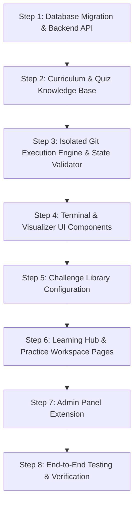

# Git & GitHub Learning and Practice Module — System Specification & Integration Plan

**Target System**: Microsoft Student Club (MSC PRPCEM) Assessment & Learning Platform  
**Architecture Classification**: Incremental Platform Extension  
**Version**: 1.0.0  
**Target Environments**: React 18+ (Vite), Node.js 18+ LTS, Express 4.19+, Sequelize ORM 6+, PostgreSQL (Neon) & SQLite (Local)  
**Document Status**: Approved Engineering Specification  

---

## Table of Contents
1. [Executive Summary & Architectural Tenets](#1-executive-summary--architectural-tenets)
2. [Codebase Inspection & Component Reuse Mapping](#2-codebase-inspection--component-reuse-mapping)
3. [Curriculum Architecture (5-Tier Progression)](#3-curriculum-architecture-5-tier-progression)
4. [Secure Interactive Git Sandbox & Virtual Engine Architecture](#4-secure-interactive-git-sandbox--virtual-engine-architecture)
5. [Repository-State Validation Engine](#5-repository-state-validation-engine)
6. [Challenge & Quiz Engine Integration](#6-challenge--quiz-engine-integration)
7. [Database Schema & Non-Destructive Migrations](#7-database-schema--non-destructive-migrations)
8. [REST API Specification](#8-rest-api-specification)
9. [Frontend User Interface & Component Architecture](#9-frontend-user-interface--component-architecture)
10. [Admin Management Panel Extension](#10-admin-management-panel-extension)
11. [Progress Tracking & Student Dashboard Integration](#11-progress-tracking--student-dashboard-integration)
12. [Security, Threat Modeling & Sandbox Isolation](#12-security-threat-modeling--sandbox-isolation)
13. [Step-by-Step Implementation Roadmap](#13-step-by-step-implementation-roadmap)

---

## 1. Executive Summary & Architectural Tenets

### 1.1 Objective
To extend the existing, production-grade MSC Quiz Platform with an integrated **Git & GitHub Learning and Practice Module** tailored for first-year engineering students, final-year students preparing for technical interviews, and recent graduates entering industry.

### 1.2 Core Architectural Tenets
1. **Zero Greenfield Rebuilding**: The existing quiz engine, scheduled assessment system, live WebSocket quiz, student Single Sign-On (SSO), and administrative portals remain untouched and 100% operational.
2. **Absolute Security & Execution Isolation**: Arbitrary shell commands are **never** executed on the backend host server. Git commands run in a client-side virtualized Git sandbox engine that simulates repository state transitions in-memory with zero host escape risk and zero server compute overhead.
3. **Repository-State Validation**: Practical challenges are graded by validating the *resulting repository state* (branches, commit tree, HEAD position, staging area, working directory contents, and remotes) rather than matching brittle typed command strings.
4. **Unified Progress Tracking**: Student progress across Git lessons, interactive challenge completions, and quiz assessments integrates into the existing user profile, database, and admin dashboard.

---

## 2. Codebase Inspection & Component Reuse Mapping

| Subsystem | Existing File / Asset | Reuse & Extension Strategy |
| :--- | :--- | :--- |
| **Database Connection** | [backend/src/config/database.js](file:///d:/Quiz-platform/backend/src/config/database.js) | Reused directly. Compatible with both PostgreSQL (Neon) and SQLite. |
| **Schema Migrations** | [backend/src/services/schemaMigration.js](file:///d:/Quiz-platform/backend/src/services/schemaMigration.js) | Extended with idempotent `CREATE TABLE IF NOT EXISTS GitProgress` and index creation queries. Existing tables remain unmodified. |
| **User Authentication** | [backend/src/models/User.js](file:///d:/Quiz-platform/backend/src/models/User.js) & [frontend/src/context/AuthContext.jsx](file:///d:/Quiz-platform/frontend/src/context/AuthContext.jsx) | Reused directly. Student accounts link progress by `email` and `user_id`. Protected routes use [RequireAuth.jsx](file:///d:/Quiz-platform/frontend/src/components/RequireAuth.jsx). |
| **Admin Role & Access** | [backend/src/models/Admin.js](file:///d:/Quiz-platform/backend/src/models/Admin.js) & [frontend/src/components/AdminLayout.jsx](file:///d:/Quiz-platform/frontend/src/components/AdminLayout.jsx) | Reused directly. Admin routes are guarded by existing JWT verification. |
| **Quiz Engine** | [backend/src/models/Quiz.js](file:///d:/Quiz-platform/backend/src/models/Quiz.js), [Question.js](file:///d:/Quiz-platform/backend/src/models/Question.js), [QuizAttempt.js](file:///d:/Quiz-platform/backend/src/models/QuizAttempt.js) | Git quizzes are registered with `subject = 'GIT'`, reusing full-screen lockdown, timer evaluation, scoring, and certificate issuance. |
| **Practice Quiz Bank** | [frontend/src/pages/PracticeQuiz.jsx](file:///d:/Quiz-platform/frontend/src/pages/PracticeQuiz.jsx) | Extended with category `'git'` containing comprehensive Git & GitHub MCQs. |
| **Course Directory** | [frontend/src/pages/Courses.jsx](file:///d:/Quiz-platform/frontend/src/pages/Courses.jsx) | The existing `"Git & GitHub"` card is activated from `'coming_soon'` to `'published'` with `'Interactive Lab Active'` badge, routing to `/courses/git`. |
| **Admin Dashboard** | [frontend/src/pages/AdminDashboard.jsx](file:///d:/Quiz-platform/frontend/src/pages/AdminDashboard.jsx) & [AdminCourses.jsx](file:///d:/Quiz-platform/frontend/src/pages/AdminCourses.jsx) | Extended to show Git learner reach, challenge completion metrics, and challenge authoring tools. |
| **Visual Design System** | [frontend/src/index.css](file:///d:/Quiz-platform/frontend/src/index.css) & Tailwind CSS | Utilizes Microsoft signature brand colors (`#0078D4`, `#F5FAFF`), pill badges, Segoe UI typography, and `lucide-react` icons. |

---

## 3. Curriculum Architecture (5-Tier Progression)

The curriculum is structured into 5 progressive levels specifically mapped to student personas:

```
┌────────────────────────────────────────────────────────────────────────┐
│                   GIT & GITHUB CURRICULUM HIERARCHY                    │
├────────────────────────────────────────────────────────────────────────┤
│ Level 1: Beginner (Foundations & Daily Workflow)                       │
│ ├── Version Control Concepts (Snapshots vs Deltas, DVCS vs CVCS)       │
│ ├── git init, Anatomy of .git (objects, refs, HEAD, config)            │
│ ├── The Three Trees (Working Directory, Staging Area / Index, Repo)    │
│ ├── git status, git add, git rm, staging strategies                    │
│ ├── git commit, commit messages, atomic commits, SHA-1 hashes          │
│ ├── git log (--oneline, --graph, --stat, filtering)                    │
│ ├── git diff (working vs staged vs HEAD)                               │
│ └── .gitignore (patterns, rules, ignoring build artifacts & secrets)   │
├────────────────────────────────────────────────────────────────────────┤
│ Level 2: Intermediate (Branching, Merging & History Manipulation)      │
│ ├── Branching Fundamentals (git branch, pointer mechanics)             │
│ ├── Switching Branches (git checkout, git switch, detached HEAD)       │
│ ├── Merging (Fast-forward vs 3-Way Recursive/Ort Merge, merge commits) │
│ ├── Rebasing (Linear history, git rebase vs git merge tradeoffs)       │
│ ├── Stashing (git stash, pop, list, drop, apply, branch)               │
│ ├── Undoing Changes (git restore, git reset soft/mixed/hard, revert)   │
│ ├── Cherry-Picking (git cherry-pick isolated commit application)       │
│ └── Merge Conflicts (Conflict markers, resolution workflow)            │
├────────────────────────────────────────────────────────────────────────┤
│ Level 3: GitHub & Remote Collaboration                                 │
│ ├── Remote Repositories (git remote add, -v, origin conventions)       │
│ ├── Synchronization (git fetch, git pull, git pull --rebase, git push) │
│ ├── Upstream Tracking (-u / --set-upstream, remote branches)           │
│ ├── Forks & Upstream Synchronization (Open source fork-and-pull model) │
│ ├── Pull Requests (PR etiquette, description templates, issue linking) │
│ ├── Code Reviews (Review comments, suggestions, approval workflows)    │
│ └── Issues, Milestones, and Project Boards                             │
├────────────────────────────────────────────────────────────────────────┤
│ Level 4: Advanced (Power Tools & Automation)                           │
│ ├── Interactive Rebase (git rebase -i, squash, reword, drop, reorder)  │
│ ├── The Safety Net: git reflog (Recovering "lost" commits & branches)  │
│ ├── Debugging History: git bisect (Binary search for regressions)      │
│ ├── Tagging (Lightweight vs Annotated tags, pushing tags, SemVer)      │
│ ├── Release Workflows (GitHub Releases, changelogs, asset uploads)     │
│ └── GitHub Actions & CI/CD (.github/workflows, triggers, jobs, steps)  │
├────────────────────────────────────────────────────────────────────────┤
│ Level 5: Real-World Scenarios & Production Workflows                   │
│ ├── Team Git Workflows (Trunk-Based Development vs GitFlow vs GitHub)  │
│ ├── Incident Recovery: Leaked Secrets Removal & Repository Scrubbing   │
│ ├── Emergency Production Hotfix Workflow                               │
│ ├── Complex Multi-Branch Merge Conflict Resolution                     │
│ └── Contributing to Open-Source (Signing commits, DCO, PR lifecycle)   │
└────────────────────────────────────────────────────────────────────────┘
```

---

## 4. Secure Interactive Git Sandbox & Virtual Engine Architecture

### 4.1 Threat Elimination Strategy
Executing arbitrary shell commands on a server (even inside standard containers) introduces risks:
- Container breakouts and privilege escalation.
- Fork bombs and compute resource exhaustion.
- Persistent filesystem pollution and concurrency bottlenecks.
- High server infrastructure costs for idle terminal sessions.

### 4.2 In-Browser Virtualized Git Engine (`gitEngine.js`)
To guarantee **100% security, zero server load, and sub-millisecond response latency**, the interactive practice environment runs on an in-browser virtual Git state machine.

```
┌─────────────────────────────────────────────────────────────────────┐
│                    VIRTUAL GIT ENGINE TOPOLOGY                      │
│                                                                     │
│  ┌───────────────────────┐         ┌─────────────────────────────┐  │
│  │   Interactive Shell   │ ◄─────► │  Command Parser & Lexer     │  │
│  │  (History, Auto-comp) │         │ (Flags, Positional Args)    │  │
│  └───────────────────────┘         └──────────────┬──────────────┘  │
│                                                   │                 │
│                                    ┌──────────────▼──────────────┐  │
│                                    │  Virtual Git Operations     │  │
│                                    │  init, add, commit, branch, │  │
│                                    │  merge, rebase, stash, reset│  │
│                                    └──────────────┬──────────────┘  │
│                                                   │                 │
│  ┌────────────────────────────────────────────────▼──────────────┐  │
│  │                 IN-MEMORY REPOSITORY STATE                    │  │
│  │  ├── Working Tree: Map<Path, FileContent>                     │  │
│  │  ├── Staging Area (Index): Map<Path, { hash, content }>       │  │
│  │  ├── Object Database: Map<SHA1, Commit | Tree | Blob>         │  │
│  │  ├── Refs & Heads: Map<BranchName, CommitSHA1>                │  │
│  │  ├── Remotes: Map<RemoteName, { url, branches }>              │  │
│  │  ├── HEAD: { type: 'branch' | 'detached', target: string }    │  │
│  │  ├── Stash Stack: Array<{ id, message, workingTree, index }>  │  │
│  │  └── Reflog: Array<{ from, to, action, message, timestamp }>  │  │
│  └────────────────────────────────────────────────┬──────────────┘  │
│                                                   │                 │
│                                    ┌──────────────▼──────────────┐  │
│                                    │ State-Based Validator       │  │
│                                    │ (Asserts repo state vs goal)│  │
│                                    └─────────────────────────────┘  │
└─────────────────────────────────────────────────────────────────────┘
```

### 4.3 Supported Commands
- **Core Operations**: `git init`, `git status`, `git add <file>`, `git add .`, `git add -A`, `git rm <file>`, `git commit -m "<msg>"`
- **Branching & Switching**: `git branch`, `git branch <name>`, `git branch -d <name>`, `git branch -m <old> <new>`, `git checkout <branch>`, `git checkout -b <name>`, `git switch <branch>`, `git switch -c <name>`
- **Inspection & History**: `git log`, `git log --oneline`, `git log --graph`, `git diff`, `git diff --staged`, `git diff <branch>`, `git reflog`
- **Merging & Integration**: `git merge <branch>`, `git merge --abort`, `git rebase <branch>`, `git rebase --abort`, `git cherry-pick <commit>`
- **State Reset & Stashing**: `git stash`, `git stash pop`, `git stash list`, `git stash drop`, `git reset --soft <commit>`, `git reset --mixed <commit>`, `git reset --hard <commit>`, `git revert <commit>`
- **Remotes & Collaboration**: `git remote`, `git remote add <name> <url>`, `git remote -v`, `git push origin <branch>`, `git push -u origin <branch>`, `git pull origin <branch>`, `git fetch`, `git clone <url>`
- **Tags & Debugging**: `git tag`, `git tag <name>`, `git tag -a <name> -m "<msg>"`, `git bisect start`, `git bisect bad`, `git bisect good`, `git bisect reset`
- **Terminal Shell Utilities**: `ls`, `cat <file>`, `touch <file>`, `echo "<content>" > <file>`, `echo "<content>" >> <file>`, `mkdir <dir>`, `rm <file>`, `pwd`, `clear`, `help`

---

## 5. Repository-State Validation Engine

### 5.1 Why State Validation Over Command-String Matching?
Command-string matching is notoriously brittle:
- Failing a student who typed `git add .` instead of `git add index.html`.
- Failing a student who checked `git status` between commands.
- Requiring rigid, artificial workflows instead of teaching Git's core model.

### 5.2 Declarative Validator Schema
Each challenge specifies an assertion predicate over the virtual repository:

```javascript
{
  id: "git-branch-merge-conflict",
  title: "Resolve a Merge Conflict on Main",
  difficulty: "Intermediate",
  track: "merge-conflicts",
  scenario: "Your teammate updated the header in main while you updated it in feature/redesign. Merge feature/redesign into main and resolve the conflict cleanly.",
  initialState: {
    branches: {
      main: {
        commits: [
          { message: "Initial commit", files: { "README.md": "# Project\n" } },
          { message: "Update header on main", files: { "header.html": "<h1>Welcome to MSC v2.0</h1>" } }
        ]
      },
      "feature/redesign": {
        baseCommit: 0,
        commits: [
          { message: "Update header redesign", files: { "header.html": "<h1>Welcome to MSC Redesign</h1>" } }
        ]
      }
    },
    currentBranch: "main"
  },
  validation: (repo) => {
    // 1. Must be on main branch
    if (repo.getHeadBranch() !== "main") {
      return { passed: false, message: "HEAD must point to the 'main' branch." };
    }
    // 2. Working directory must be clean
    if (!repo.isWorkingTreeClean()) {
      return { passed: false, message: "Working tree is dirty. Stage and commit your changes." };
    }
    // 3. Staging area must be clean
    if (!repo.isIndexClean()) {
      return { passed: false, message: "Staging area has uncommitted changes. Complete the merge commit." };
    }
    // 4. No unresolved conflict markers in files
    const headerContent = repo.readFile("header.html");
    if (!headerContent || headerContent.includes("<<<<<<<") || headerContent.includes("=======") || headerContent.includes(">>>>>>>")) {
      return { passed: false, message: "Conflict markers (<<<<<<<, =======, >>>>>>>) remain in header.html." };
    }
    // 5. Commit history must show a merge commit combining both branches
    const latestCommit = repo.getLatestCommit();
    if (latestCommit.parentIds.length < 2) {
      return { passed: false, message: "Latest commit on main must be a merge commit combining both parent branches." };
    }
    return { passed: true, message: "Merge conflict successfully resolved and committed!" };
  },
  hints: [
    "Run `git merge feature/redesign` to initiate the merge.",
    "Open header.html or use `cat header.html` to see the conflict markers.",
    "Edit header.html with `echo \"<h1>Resolved Header</h1>\" > header.html`.",
    "Stage the resolved file using `git add header.html` and commit with `git commit -m \"Resolve merge conflict\"`."
  ]
}
```

---

## 6. Challenge & Quiz Engine Integration

### 6.1 Quiz Engine Integration
The Git module seamlessly plugs into the existing assessment system:
1. **Practice Quizzes**: Extended via [PracticeQuiz.jsx](file:///d:/Quiz-platform/frontend/src/pages/PracticeQuiz.jsx) under the `'git'` category.
2. **Curriculum Concept Quizzes**: Built-in 5-question knowledge checks at the end of each curriculum module in [GitCourseHub.jsx](file:///d:/Quiz-platform/frontend/src/pages/GitCourseHub.jsx).
3. **Formal Assessments**: Administrators can create scheduled exams in [QuizManagement.jsx](file:///d:/Quiz-platform/frontend/src/pages/QuizManagement.jsx) with `subject: 'GIT'`, generating proctored tests with full-screen enforcement, violation tracking, and verifiable certificates.

### 6.2 Learning Loop Architecture
Students progress sequentially through a 3-step loop:
1. **Learn**: Study concepts, inspect interactive visual diagrams, copy command examples.
2. **Check (Quiz)**: Test conceptual comprehension via instant MCQs and scenario checks.
3. **Practice (Terminal)**: Execute real Git commands in the interactive sandbox to solve the corresponding repository challenge.

---

## 7. Database Schema & Non-Destructive Migrations

### 7.1 `GitProgress` Entity Specification
A dedicated table tracks student achievements without modifying existing `Users`, `Quizzes`, or `QuizAttempts` tables.

```sql
-- Safe Idempotent Schema Creation for PostgreSQL & SQLite
CREATE TABLE IF NOT EXISTS "GitProgress" (
  "id" UUID PRIMARY KEY,
  "user_id" UUID,
  "user_email" VARCHAR(255) NOT NULL,
  "completed_lessons" TEXT DEFAULT '[]',
  "completed_challenges" TEXT DEFAULT '[]',
  "quiz_scores" TEXT DEFAULT '{}',
  "skill_level" VARCHAR(50) DEFAULT 'Beginner',
  "last_active_lesson" VARCHAR(255),
  "achievements" TEXT DEFAULT '[]',
  "createdAt" TIMESTAMP WITH TIME ZONE NOT NULL,
  "updatedAt" TIMESTAMP WITH TIME ZONE NOT NULL
);

CREATE INDEX IF NOT EXISTS "idx_git_progress_email" ON "GitProgress" ("user_email");
CREATE INDEX IF NOT EXISTS "idx_git_progress_user_id" ON "GitProgress" ("user_id");
```

### 7.2 Field Definitions & Constraints
- `id`: Unique identifier (UUIDv4).
- `user_id`: Loose foreign key to `Users.id` (optional for unauthenticated guest session synchronization).
- `user_email`: Normalized, lowercased student email (Indexed).
- `completed_lessons`: JSON array storing completed lesson slugs (e.g. `["git-basics", "git-init", "three-trees"]`).
- `completed_challenges`: JSON array storing solved challenge IDs (e.g. `["git-init-first-commit", "git-branch-create-switch"]`).
- `quiz_scores`: JSON dictionary of `{ [quizSlug]: { score, total, percentage, passed, completedAt } }`.
- `skill_level`: Current computed badge: `'Novice'` (0-5 challenges) -> `'Branch Master'` (6-12) -> `'Git Ninja'` (13-20) -> `'Open Source Lead'` (20+).
- `last_active_lesson`: Slug of the last visited lesson for 1-click resumption.
- `achievements`: JSON array of unlocked achievement badges.

---

## 8. REST API Specification

### 8.1 Public & Student Endpoints
All endpoints are mounted under `/api/git` in [backend/src/server.js](file:///d:/Quiz-platform/backend/src/server.js):

| Method | Endpoint | Description | Auth Required |
| :--- | :--- | :--- | :--- |
| `GET` | `/api/git/curriculum` | Returns all 5 curriculum tiers, modules, and topics | No |
| `GET` | `/api/git/challenges` | Returns active challenges, initial states, and goals | No |
| `GET` | `/api/git/challenges/:id` | Returns single challenge specification with starter repo state | No |
| `GET` | `/api/git/progress` | Fetches student progress by session token or email | Optional (Student/Guest) |
| `POST` | `/api/git/progress/lesson` | Marks a lesson as completed | Yes (Student) |
| `POST` | `/api/git/progress/challenge` | Records solved practical challenge and updates skill level | Yes (Student) |
| `POST` | `/api/git/progress/quiz` | Persists quiz score for a curriculum knowledge check | Yes (Student) |
| `GET` | `/api/git/leaderboard` | Returns top Git practitioners by challenges solved & score | No |

### 8.2 Admin Endpoints
Mounted under `/api/admin/git` (guarded by Admin JWT):

| Method | Endpoint | Description |
| :--- | :--- | :--- |
| `GET` | `/api/admin/git/stats` | Overall module adoption, completion counts, and active learners |
| `POST` | `/api/admin/git/challenges` | Author or update custom interactive challenges |
| `DELETE` | `/api/admin/git/challenges/:id` | Soft-delete or archive a challenge |
| `POST` | `/api/admin/git/reset-student` | Reset student progress for testing or retakes |

---

## 9. Frontend User Interface & Component Architecture

### 9.1 New Pages
1. **[GitCourseHub.jsx](file:///d:/Quiz-platform/frontend/src/pages/GitCourseHub.jsx)** (`/courses/git` and `/git`):
   - **Overview Tab**: Student progress bar, skill tier badge, completion statistics, 30-day mastery roadmap preview, recommended next action.
   - **Learn Tab**: Left-hand module accordion (Beginner, Intermediate, GitHub, Advanced, Real-World) with search filter. Right-hand markdown lesson reader with command cheat-sheets and diagrams.
   - **Practice Tab**: LeetCode-style challenge list with track filters, difficulty badges, solve status, and direct launch button.
   - **Roadmap Tab**: 30-day step-by-step developer roadmap.
   - **Quiz Tab**: Knowledge checks with immediate feedback, detailed explanations, and score recording.
2. **[GitPractice.jsx](file:///d:/Quiz-platform/frontend/src/pages/GitPractice.jsx)** (`/practice/git/lab` and `/practice/git/:challengeId`):
   - Split-pane terminal workspace:
     - **Left Column**: Challenge title, background story, step-by-step objectives, hints accordion, reset button.
     - **Top Right**: Interactive Repository Visualizer.
     - **Bottom Right**: Interactive Terminal Emulator.
     - **Validation Overlay**: State validation modal with celebratory confetti on completion.

### 9.2 New Reusable Components
1. **[GitTerminal.jsx](file:///d:/Quiz-platform/frontend/src/components/GitTerminal.jsx)**:
   - Command history navigation (Up/Down arrow keys).
   - Tab auto-completion for Git commands and files.
   - Colorized output (ANSI green for staged, red for modified/untracked, yellow for hashes, cyan for branch names).
   - Prompt: `student@msc-repo:~/project (main) $ `.
2. **[GitVisualizer.jsx](file:///d:/Quiz-platform/frontend/src/components/GitVisualizer.jsx)**:
   - Dynamic SVG/HTML visual commit tree with connected parent nodes.
   - Floating branch badges (`main`, `feature/auth`) and `HEAD` pointer.
   - 3-column stage inspector: Working Directory ➔ Staging Area (Index) ➔ Committed Tree.
3. **[AdminGit.jsx](file:///d:/Quiz-platform/frontend/src/pages/AdminGit.jsx)**:
   - Challenge manager: Add new custom challenges, customize starter files, and configure validation assertions.

---

## 10. Admin Management Panel Extension

Integrated into the existing [AdminLayout.jsx](file:///d:/Quiz-platform/frontend/src/components/AdminLayout.jsx) under the **COURSES & LEARNING** section:
- **Challenge Directory**: View, activate, and edit challenges.
- **Learner Activity**: View real-time active students, completion rates, and average solve times.
- **Certificate Issuance**: Verify students who have completed all tiers and issue verified MSC certificates via [studentSync.js](file:///d:/Quiz-platform/backend/src/routes/studentSync.js).

---

## 11. Progress Tracking & Student Dashboard Integration

### 11.1 Synchronization Flow
1. When a student completes a lesson, solves a challenge, or takes a quiz, the state updates instantly in React state and `localStorage` (ensuring 100% offline resilience).
2. If authenticated, an asynchronous background request synchronizes the updated progress to `POST /api/git/progress/challenge`.
3. The student dashboard displays:
   - **Overall Progress**: Percentage of curriculum completed.
   - **Mastery Rank**: e.g., "Level 3: Git Ninja (14/25 Challenges Solved)".
   - **Recent Activity**: Last 5 solved challenges and quiz scores.
   - **Next Recommended Step**: Dynamically calculated based on the earliest uncompleted lesson.

---

## 12. Security, Threat Modeling & Sandbox Isolation

| Threat Vector | Mitigation Strategy |
| :--- | :--- |
| **Arbitrary Shell Execution (RCE)** | **Eliminated by Design**: Git commands are interpreted in-memory by `gitEngine.js` in the client browser. No backend bash/sh shell process is ever spawned. |
| **Server Resource Exhaustion (DoS)** | Client-side execution offloads 100% of the CPU/memory cost to the user's browser, enabling infinite scaling without server infrastructure degradation. |
| **Filesystem Pollution** | Virtual repositories exist strictly in JavaScript memory per session. Resetting the repository instantly reinstates initial states without disk I/O. |
| **Cheat Prevention** | Validation inspects the internal state of the commit graph, file hashes, and branch pointers. Blind command string replays without achieving correct repository state will fail. |
| **Session Hijacking** | All progress synchronization endpoints require valid JWT authentication with strict rate-limiting via existing `generalLimiter`. |

---

## 13. Step-by-Step Implementation Roadmap



1. **Step 1**: Create [GitProgress.js](file:///d:/Quiz-platform/backend/src/models/GitProgress.js), update [schemaMigration.js](file:///d:/Quiz-platform/backend/src/services/schemaMigration.js), and mount [gitApi.js](file:///d:/Quiz-platform/backend/src/routes/gitApi.js).
2. **Step 2**: Author [gitCurriculumData.js](file:///d:/Quiz-platform/frontend/src/data/gitCurriculumData.js) and [gitQuizzesData.js](file:///d:/Quiz-platform/frontend/src/data/gitQuizzesData.js).
3. **Step 3**: Implement [gitEngine.js](file:///d:/Quiz-platform/frontend/src/services/gitEngine.js) virtual sandbox with full command support and declarative state validation.
4. **Step 4**: Build [GitTerminal.jsx](file:///d:/Quiz-platform/frontend/src/components/GitTerminal.jsx) and [GitVisualizer.jsx](file:///d:/Quiz-platform/frontend/src/components/GitVisualizer.jsx).
5. **Step 5**: Configure 20+ interactive challenges in [gitChallenges.js](file:///d:/Quiz-platform/frontend/src/data/gitChallenges.js).
6. **Step 6**: Implement [GitCourseHub.jsx](file:///d:/Quiz-platform/frontend/src/pages/GitCourseHub.jsx) and [GitPractice.jsx](file:///d:/Quiz-platform/frontend/src/pages/GitPractice.jsx), then register routes in [App.jsx](file:///d:/Quiz-platform/frontend/src/App.jsx) and activate [Courses.jsx](file:///d:/Quiz-platform/frontend/src/pages/Courses.jsx).
7. **Step 7**: Build [AdminGit.jsx](file:///d:/Quiz-platform/frontend/src/pages/AdminGit.jsx) and update [AdminLayout.jsx](file:///d:/Quiz-platform/frontend/src/components/AdminLayout.jsx).
8. **Step 8**: Run regression tests on existing live and scheduled quizzes, then verify new Git features.
